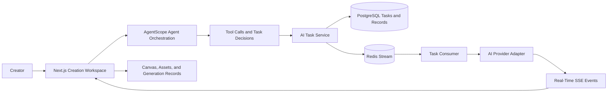

<p align="right"><a href="README.md">Simplified Chinese</a> · <b>English</b></p>

<p align="center">
  
</p>

<h1 align="center">Novanova Studio</h1>

<p align="center">
  An AI Agent-powered visual creation workspace where ideas, generation, editing, composition, and reusable results stay connected through persistent context.
</p>

<p align="center">
  <a href="https://www.novanovastudio.cn/">>>>> Try it online if deployment or finding affordable providers feels cumbersome <<<<</a>
</p>

<p align="center">
  
</p>
<p align="center">
  
</p>
<p align="center">
  
</p>
<p align="center">
  
</p>
<p align="center">
  
</p>

## 🚀 Docs

[Docs](https://www.novanovastudio.cn/docs/en)


## ✨ What It Is

Novanova Studio is an AI creation workspace for independent creators and visual teams. Rather than separating images, videos, prompts, and generation records across multiple tools, it uses an **infinite canvas** as the creative context and an **AI Agent** as the center for understanding intent, choosing tools, and advancing tasks.

Creators can start with a natural-language goal or reference materials, then continue to converse, generate, edit, compare, and reuse results across image, video, and canvas workflows. Generation records, assets, prompts, and canvas nodes remain connected in the same creative workflow.

## 🧠 An Agent Across the Creative Workflow

The Agent is not an isolated chat window or a one-off endpoint that forwards model requests. It spans the complete workflow, from intent understanding to preserving results:



| Stage | Agent and System Responsibilities | Creative Experience |
| --- | --- | --- |
| 1. Define an intent | Accept natural language, image references, or video references, then select the relevant Agent Profile (capability configuration) for the image, video, or canvas workflow. | Start with a description or existing material. |
| 2. Choose tools | Use the context to invoke image generation, image editing, video generation, video editing, history queries, or canvas operations. | Avoid repeatedly switching among feature pages. |
| 3. Create a task | Validate model capabilities and credits, save a task snapshot to PostgreSQL, and submit it to a Redis Stream consumer group. | Long-running generation does not block the current workflow. |
| 4. Execute and report | Task consumers call configured AI providers; task status, tool calls, and results are delivered to the frontend through SSE (Server-Sent Events). | View progress, failures, or cancellations in real time in conversations and on the canvas. |
| 5. Preserve context | Save generation results to generation records for continued use on the canvas and optional addition to the asset library. Canvas Agents can continue using node state and tool results. | Later edits and reuse retain the context from previous rounds of creation. |

### Agent Capabilities

| Workflow | Agent Capabilities | Result Destination |
| --- | --- | --- |
| Image creation | Invoke image generation, reference-image editing, and history-query tools in response to the conversation. | Conversation turns, generation records, and canvas image nodes; optionally added to the asset library. |
| Video creation | Invoke video generation, video editing, and history-query tools, while validating image or video references against model capabilities. | Conversation turns, generation records, and canvas video nodes; optionally added to the asset library. |
| Infinite canvas | Read the current canvas state; create, update, move, scale, delete, and connect nodes; create text, image, or video generation flows and start tasks. | Editable canvas projects and node relationships. |
| Prompt optimization | Apply independent strategies to optimize image and video prompts, then update the input only after optimization succeeds. | The current creation input; the original prompt is retained if optimization fails. |
| Live coordination | The frontend returns canvas tool results to the server-side Agent after each tool execution, allowing the Agent to continue based on actual results. | A continuous "conversation -> tool -> result -> continued conversation" experience. |

## 🎨 Core Features

- **Infinite canvas**: Compose text, images, videos, reference materials, and generation results in one space while retaining creative context.
- **Conversational image and video generation**: Generate, edit, reference historical results, and iterate further within one conversation.
- **Multi-provider model configuration**: Manage AI providers, model capabilities, default models, and credit consumption rules in Configuration & User Preferences; video models support tiered credit pricing by specifications such as resolution and duration.
- **Assets and generation records**: Save reusable assets, generation history, and prompts to reduce repeated uploads and configuration.
- **Object storage integration**: Supports Tencent Cloud COS, Alibaba Cloud OSS, and Qiniu Kodo for uploads and generated results.
- **User and operations features**: Email login, OAuth2 login, credits with a canvas-header balance shortcut and filterable credit history, notifications, a prompt library, home-page showcases, and an administrator console.
- **Asynchronous task processing**: Redis Stream consumer groups, task locks, failure recovery, and SSE event streams support traceable long-running tasks.

## 🌟 Key Advantages

### 🧠 Agent-driven creative context

The Agent is more than a one-shot model gateway. It spans intent understanding, tool selection, task orchestration, result feedback, and the next creative round. Conversations, generation records, materials, and canvas nodes can reference one another without repeatedly rebuilding context across separate tools.

### 🎨 An infinite canvas for the whole process

Text, reference materials, images, videos, generation tasks, and results can be arranged on one canvas. The Canvas Agent can read node state and create, move, scale, connect, and generate nodes, turning the canvas into an editable creation project rather than a result gallery.

### 🧩 Skills and workflows for complex creation

Skills use configurable prompts to guide users through structured interactions, while workflows define stages, task roles, and state transitions. For example, the first/last-frame video workflow (`first-last-frame-to-video`) can move from clarification and prompt confirmation to first-frame generation, last-frame generation, and video composition. First-frame and last-frame references are passed with explicit media roles to compatible providers, and a quote is shown only when the required model capabilities and credit prices are configured for every stage; the same mechanism is available for future workflows.

### 🔌 Open model and provider integration

Provider adapters are separated from model capability configuration. The project supports OpenAI-compatible, Gemini, Agnes, Seedance, MiniMax, and Evolink providers, as well as self-hosted image or video APIs through request/response templates. Administrators can configure model display names, icons, capabilities, visibility, and billing rules independently; models switched off stay hidden from user dropdowns.

### ⚡ Reliable execution for long-running tasks

Image and video generation run through Redis Stream asynchronous queues, with task locks, status polling, real-time SSE events, cancellation, failure recovery, and a unified polling setting. This keeps video-generation tasks traceable without blocking the creation interface.

### 🔒 Private deployment with operational controls

Provider keys and object-storage credentials stay on the server. Docker Compose, PostgreSQL, Redis, and multiple object-storage options support private deployment. The administrator console covers models, skills, styles, prompt covers, result details, credit history, and API access logs for team or business operations.The architecture used in the project is based on mainstream Java frameworks, facilitating enterprise-level scalability and naturally supporting microservice architectures like SpringCloud and K8s.

## 🤖 Supported Models and Providers

The project selects an adapter by a provider's `apiFormat` (API request format). Administrators synchronize and configure model names from providers, so there is no fixed, exhaustive model allowlist. Any model that implements the corresponding provider protocol and API can be added to the relevant image, video, or chat model catalog. Actual availability still depends on the models enabled for the provider account.

### Provider Capability Matrix

| Provider Format | Image Generation | Video Generation | Chat / Primary Agent | Default Base URL | Notes |
| --- | --- | --- | --- | --- | --- |
| OpenAI-compatible (`openai`) | ✅ | ✅ | ✅ | `https://api.openai.com/v1` | Supports OpenAI's official service and compatible providers that implement the same API protocol. |
| Gemini (`gemini`) | ✅ | ❌ | ✅ | `https://generativelanguage.googleapis.com/v1beta` | Uses Gemini's native `generateContent` API. |
| Agnes (`agnes`) | ✅ | ✅ | ⚠️ | Configured by the administrator | The text-task adapter supports Agnes Chat Completions, but the AgentScope model factory for the primary Agent does not yet support Agnes. |
| Anthropic (`anthropic`) | ❌ | ❌ | ✅ | `https://api.anthropic.com/v1` | Uses the Anthropic Messages API for Claude models. |
| Seedance (`seedance`) | ❌ | ✅ | ❌ | `https://ark.cn-beijing.volces.com/api/v3` | Uses the Volcano Engine Ark video-generation task API. |
| MiniMax (`minimax`) | ❌ | ✅ | ❌ | `https://api.minimaxi.com` | Uses the MiniMax H3 video-generation V2 API; the model must be configured manually. |
| Evolink (`evolink`) | ❌ | ✅ | ❌ | `https://api.evolink.ai/v1` | Uses Evolink's native asynchronous video-generation API and supports model-list synchronization. |
| Custom (`custom`) | ✅ | ✅ | ❌ | Configured by the administrator | Calls self-hosted image or video APIs through per-model request/response templates; asynchronous video polling is supported and models must be entered manually. |

> ⚠️ A model being available from a provider does not mean it has the corresponding generation capability. Administrators must still mark each model as text, image, or video, configure its specific capabilities, and set default models for each type.

## ⚙️ Technical Architecture

| Layer | Main Technologies | Purpose |
| --- | --- | --- |
| Web | Next.js 16, React 19, TypeScript, Ant Design 6, Tailwind CSS, Zustand, React Flow | Creation workspace, conversations, canvas, and configuration interface. |
| Server | Java 21, Spring Boot 3.5, Spring WebFlux, AgentScope Java, Fastjson2 | Reactive APIs, Agent orchestration, task scheduling, authentication, and business services. |
| Data and tasks | PostgreSQL 17, Flyway, R2DBC (reactive database connectivity), Redis 8.6, Redis Stream | Persistence for users, projects, tasks, assets, and generation records; asynchronous task delivery and recovery. |
| AI and storage | OpenAI-, Evolink-, Gemini-, Agnes-, Anthropic-, Seedance-, and MiniMax-format providers; COS, OSS, Kodo | Connect models and object storage through the administrator console instead of exposing credentials in the browser. |
| Deployment | Docker Compose, Nginx, Node.js 22, Maven | Local dependencies, containerized builds, and Linux server deployment. |

## 📁 Repository Layout

```text
.
├── web/                         # Next.js frontend and creation workspace
├── server/                      # Spring Boot, Agent, and task services
│   ├── config/prompts/          # Image, video, canvas Agent, and prompt-optimization templates
│   └── src/main/resources/      # Application configuration and Flyway database migrations
├── docker-compose.yml           # PostgreSQL, Redis, frontend, backend, and Nginx orchestration
├── .env.example                 # Example local and deployment environment variables
├── docs/                        # Public Chinese/English user guides (MDX)
├── docs-api/                    # API, database, ADR, and engineering reference docs
└── logo/                        # Project brand assets
```

## 🚀 Run Locally or Deploy

### Local Development

- [Guide to Running and Debugging from Source](deploy_docs/local-source-development.md)

### Server Deployment

- [Complete Docker Deployment Guide](deploy_docs/docker-deploy.md)

Docker deployments run Flyway migrations automatically; the current branch must migrate through `V28__Add_Password_Reset.sql`. Production deployments should also configure `APP_SECRET_KEY`, `FRONTEND_BASE_URL`, trusted proxy addresses via `TRUSTED_PROXY_ADDRESSES`, and the unified AI-task polling interval `AI_TASK_POLLING_INTERVAL_SECONDS`. See the [Docker Deployment Guide](deploy_docs/docker-deploy.md) for details.

## 📚 Related Documentation

- [Novanova Studio documentation portal](/docs)
- [Engineering and API documentation](docs-api/)
- [Product Overview](PRODUCT.md)
- [Open Source License](LICENSE)

## External Links

- [Linux Do Open Source Community](https://linux.do/)
- [AgentScope Java](https://java.agentscope.io/v2/en/intro.html)

## Contact

mail: zhenglin.cn.cq@gmail.com
