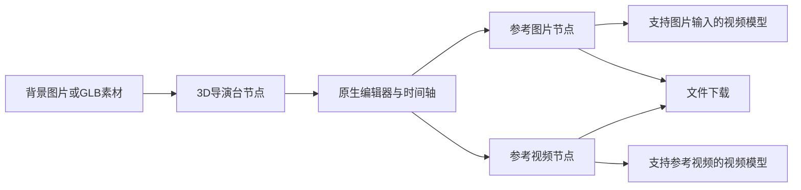
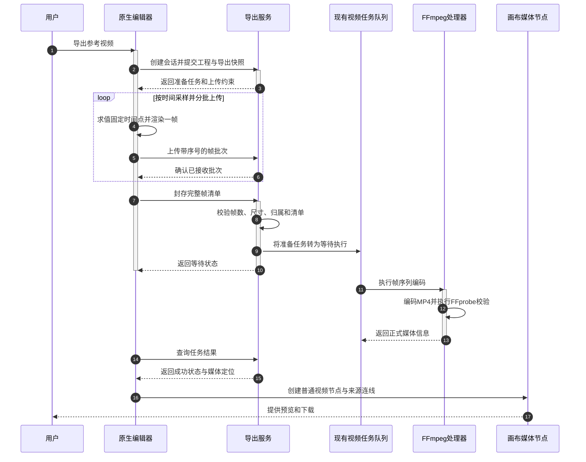

# 3D 导演台画布集成方案

日期：2026-10-11。状态：**需求与技术路线已确认，功能尚未实现**。

本方案用于制作可控的 3D 预演参考图片与视频，并通过画布现有引用链路交给视频生成模型。它是原生 React 功能，不使用 iframe，也不直接合并两个参考项目的完整应用。

架构决策：[ADR-016：3D 导演台原生集成与参考媒体导出](../docs/adr/ADR-016-3D导演台原生集成与参考媒体导出.md)。

术语说明：GLB 是把模型及其相关数据封装在一个文件中的三维模型格式；WebGL 是浏览器的图形渲染接口；React Three Fiber 是在 React 中组织 Three.js 场景的渲染器；FFmpeg 负责媒体编码，FFprobe 负责探测真实媒体信息。

## 1. 已确认的需求与边界

以下结论来自本次 `grill-me` 需求访谈，已由用户逐项确认。

| 决策     | 已确认内容                                                                           |
| -------- | ------------------------------------------------------------------------------------ |
| 接入方式 | 原生 React 编辑器，不使用 iframe                                                     |
| 画布形态 | 新增“3D 导演台”节点；每个节点保存一个场景和一条时间轴                                |
| 镜头组织 | 一个场景可以保存多个机位，选择机位分别导出；多个镜头用多个节点组织                   |
| 动作控制 | 支持人物位移、姿势或预设动作，以及摄像机关键帧                                       |
| 视觉目标 | 轻量人偶与基础场景预演，重点表达构图、动作、遮挡与运镜                               |
| 素材范围 | 内置人偶、基础几何体、背景图、GLB 静态场景与道具                                     |
| 视频路线 | 浏览器按固定时间步逐帧渲染，临时上传帧，服务端 FFmpeg 编码                           |
| 结果使用 | 导出后创建普通图片或视频节点，保留来源连线，同时提供下载                             |
| 图片格式 | PNG，支持当前时间点的机位画面                                                        |
| 视频预设 | 无音轨 MP4、H.264、30 帧/秒、720p、2～15 秒                                          |
| 画幅     | 横屏 16:9、竖屏 9:16、方形 1:1                                                       |
| 项目复用 | 以 MIT 导演台为基础；未取得 awplanet 商业授权，只借鉴能力与架构                      |
| 首版排除 | 手机虚拟拍摄、多场景剪辑、完整游戏物理、写实成片、音频与口型、导入角色的自动骨骼适配 |

“已确认”表示方案边界确定，不表示已有代码、运行验证或模型效果保证。本次任务只编写方案与 ADR。

## 2. 用户工作流

1. 在画布工具栏或右键菜单创建“3D 导演台”节点。
2. 打开编辑器，添加人物、几何体、GLB 道具和背景图。
3. 设置人物姿势、运动轨道、动作片段和机位关键帧。
4. 拖动时间轴预览，选择一个机位及导出画幅。
5. 导出当前时间点的图片，或导出整个时间轴的视频。
6. 导出成功后，在导演台旁创建对应媒体节点并连接来源节点。
7. 将图片连到图生视频或首尾帧视频节点，将视频连到支持参考视频的生成节点。

导演台节点保存可编辑工程；媒体节点保存一次导出的确定结果。重新编辑工程不会覆盖已导出的图片、视频或历史生成任务。

## 3. 两个参考项目的使用方式

| 来源                       | 可以沿用或借鉴的能力                                                                              | 不直接搬入的内容                                                       |
| -------------------------- | ------------------------------------------------------------------------------------------------- | ---------------------------------------------------------------------- |
| `storyai-3d-director-desk` | MIT 源码中的程序化人偶、姿势、机位几何、场景摆放、画幅与截图思路                                  | Vite 应用壳、宿主通信桥、全局 CSS、单例工程状态、localStorage 工程保存 |
| `awplanet`                 | 人物运动与摄像机轨道分离、时间轴采样、预览与导出协作、结构化场景命令的设计思路                    | 未经商业授权的源码、界面、品牌、模型和纹理；实时录制作为正式导出路径   |
| 本项目                     | 画布节点注册、节点动作上下文、服务端保存、媒体与对象存储、引用解析、视频任务队列、FFmpeg 生命周期 | 新建平行的画布、模型适配、任务队列或媒体存储系统                       |

复用 MIT 源码时保留版权和许可声明，并记录具体文件来源。模型与贴图单独核对许可：原导演台内置的 UE 人偶模型使用独立的 Sketchfab Standard 许可，不默认随功能分发；首版优先使用程序化人偶。

两个参考项目均使用 React 18；本项目使用 React 19。实施时应选择与 React 19 匹配的 React Three Fiber、Drei 和 Three.js 版本，并完成小范围兼容验证。不能直接照搬原项目依赖版本，或安装第二份 React。

原导演台的 `walk`、`run` 等姿势名称并不意味着已有连续动作动画。站姿与关节参数可以复用，连续动作、位移轨道和确定性时间轴需要实现。

## 4. 首版功能清单

| 模块     | 首版内容                                                       | 完成判据                                   |
| -------- | -------------------------------------------------------------- | ------------------------------------------ |
| 场景编辑 | 添加、选择、复制、删除、移动、旋转、缩放；对象可见性与锁定     | 保存、刷新、复制节点后场景一致             |
| 人物     | 内置体型与姿势，关节调整；站立、行走、奔跑、挥手等轻量预设动作 | 动作有连续运动，不能用静态姿势代替动画     |
| 人物轨道 | 位置与朝向关键帧，姿势过渡，预设动作片段                       | 任意时间点可预览，跳播结果与顺序播放一致   |
| 场景素材 | 基础几何体、背景图、单文件 GLB 静态模型                        | 素材随画布保存并能重新加载                 |
| 机位     | 多机位保存、选定机位、视场角、位置、目标点及关键帧             | 推拉、平移、环绕可通过关键帧表达           |
| 时间轴   | 一条场景时间轴，人物与机位轨道；播放、暂停、跳转、关键帧增删   | 图片与视频使用同一时间求值结果             |
| 图片导出 | 当前机位与当前时间点 PNG                                       | 画幅准确，没有网格、标签、坐标轴与编辑控件 |
| 视频导出 | 2～15 秒，30 帧/秒，固定时间步渲染并编码 MP4                   | 帧数、时长、画幅与编码实测通过             |
| 画布输出 | 自动创建普通媒体节点、来源连线、预览、下载                     | 普通图片和视频引用链路可识别结果           |

首版将 GLB 作为静态场景或道具加载，不承诺任意导入人物都可驱动动作。FBX、OBJ、多文件 glTF、动画重定向和复杂地形作为后续独立扩展，不进入本轮实现范围。

## 5. 原生编辑器与状态边界

### 5.1 画布节点与编辑器

- 节点只展示封面、时长、导出状态和编辑入口，不常驻完整 3D 视口。
- 编辑入口打开覆盖工作区的大型编辑面板，内部为对象树、3D 视口、属性面板和底部时间轴。
- 通过现有 `nodeTypes` 和 `NodeActionContext` 接入，不增加只转发属性的包装组件。
- 重型 3D 模块仅在打开编辑器时动态加载；采用客户端渲染，服务端渲染阶段不访问浏览器或 WebGL。
- 同一画布同时只打开一个导演台编辑器。关闭后释放 WebGL 资源、监听器和临时对象地址。
- 画布拖拽、编辑器空间操作、键盘快捷键各自限定作用域；输入框与弹窗拥有焦点时不响应场景快捷键。
- 沿用 `canvasThemes`、主题 store 和 Ant Design token，支持当前深色、浅色与紫色主题；编辑辅助颜色与导出场景颜色分离，切换界面主题不能改变成片。

### 5.2 状态与持久化

- 场景数据由导演台节点持有，随 `CanvasDocument` 保存到现有服务端画布文档。
- 播放时间、选择对象、拖动中状态、渲染器和加载器只在编辑器运行期存在。
- 打开节点时构造对应工程的 store；禁止两个节点共用原项目的单例 Zustand 场景。
- 编辑操作同步节点工程数据并增加工程修订号，复用画布保存调度。撤销操作按一次完整拖动或一次参数提交记录，避免逐帧写入历史与数据库。
- 业务工程、GLB、截图和大 JSON 不写入 localStorage。确有恢复草稿需求时使用 localforage，服务端画布文档仍为正式数据来源。
- 新增导演台私有组件与状态按 AGENTS.md 放在 `web/src/app/(user)/canvas/director-desk/`；现有注册与领域扩展仍在 `web/src/features/canvas/`，不重排已有代码目录。

## 6. 工程与媒体数据设计

在 `CanvasNodeKind` 增加 `directorDesk`，定义对应的 `CanvasDirectorDeskNode`。以下字段是拟新增契约，不是已存在的接口。

| 数据     | 主要字段                                                                                                      | 说明                                                     |
| -------- | ------------------------------------------------------------------------------------------------------------- | -------------------------------------------------------- |
| 节点     | `id`、`kind`、`title`、`frame`、`execution`、`director`                                                       | 沿用画布节点基础字段                                     |
| 导演台   | `schemaVersion`、`projectRevision`、`project`、`cover`、`exportSettings`                                      | 工程版本、修订号、封面和用户导出设置                     |
| 场景     | `objects`、`assets`、`cameras`、`timeline`、`selectedCameraId`                                                | 一个场景，多个可选机位，一条时间轴                       |
| 物体     | `id`、`name`、`kind`、`transform`、`visible`、`locked`、`assetId`                                             | 几何体、人偶与静态模型                                   |
| 资产     | `storageKey`、`mimeType`、`bytes`、`objectStorage`                                                            | 保存稳定定位信息，不能只保存临时 blob 地址               |
| 时间轴   | `durationMilliseconds`、人物轨道、机位轨道                                                                    | 工程单位统一，字段使用全称                               |
| 导出快照 | 画布与节点标识、工程修订号、机位、工程快照、帧率、画幅、已封存帧清单                                          | 工程与参数发起后不可变；清单接收期间只追加，封存后不可变 |
| 结果来源 | `sourceCanvasDocumentId`、`sourceDirectorNodeId`、`sourceProjectRevision`、`sourceCameraId`、时间点或时间范围 | 用于追溯媒体来自哪次导出                                 |

位置按米保存，内部旋转用弧度或四元数，界面可以显示角度；单位在数据契约中固定。三维对象、Three.js 实例、材质和纹理实例不能写入工程 JSON。

复制节点时深拷贝工程；内部对象标识可在新的节点作用域内保留，跨画布节点标识和来源连线按现有复制规则重映射。导出快照及历史媒体不会因复制而重新生成。

背景图片被使用时保存该次素材定位和内容快照。替换上游图片后提示可更新背景，由用户明确应用，不自动修改正在编辑的场景或进行中的导出。

首版无需新建独立场景主表：当前画布文档已完整保存 JSONB。导出准备状态与临时资源生命周期的必要表结构变更应新增 Flyway 版本，同时更新 `docs-api/backend-database.md`；本次方案编写不修改实际数据库定义。

导出前确认该工程修订已成功保存，失败时保留编辑内容并明确提示，不创建与服务端工程不一致的导出会话。画布标识放在专用导出快照中，不把既有任务的漫剧 `projectId` 字段当作画布标识复用。

## 7. 确定性时间轴与预览

采用统一的“工程与时间点 → 场景状态”求值函数，预览、图片导出、视频导出都调用它。

1. 根据时间点查找人物和摄像机轨道上的相邻关键帧。
2. 使用 Three.js 已有向量插值、四元数插值与动画求值能力，避免手写旋转算法。
3. 将人物根节点位移、关节姿势和动作片段分别求值，再按固定优先级合成。
4. 对摄像机位置、目标点、视场角求值，更新完整场景矩阵并渲染。

必须明确的行为：

- 同一时间点求值不依赖此前播放了多少帧，不使用累积 `delta` 推进正式导出。
- 动作片段按绝对时间计算循环与姿势。导入动画未来可使用绝对时间求值，不能只调用累积更新。
- 用户关节关键帧优先于同关节预设动作；同一人物同一时段的两个动作片段不允许重叠，首版避免隐含动画混合。
- 位移轨道与动作节奏分开保存，提供合理默认步速，并检查明显滑步；首版不引入完整碰撞与动力学系统。
- 相机朝向使用目标点控制；人物朝向使用旋转轨道，避免多套朝向字段互相覆盖。
- 缺失机位、重复时间的冲突关键帧、不可加载资产或不支持的工程版本必须明确报错，不用替代素材继续导出。

视频按帧数定义精确时长：`总帧数 = 时长秒数 × 30`。时间轴范围须落在帧边界，超出范围或不在帧边界的输入由界面明确校正并展示；服务端再次验证整数帧数。

第 `i` 帧的时间为 `i / 30` 秒，`i` 从 0 到总帧数减 1。15 秒视频共 450 帧，最后一帧时间是 14.966… 秒。帧文件和接口对外序号从 1 开始，第一帧序号 1 对应时间 0；不要混淆时间计算下标与上传序号。

## 8. 图片与视频导出

### 8.1 首版导出预设

| 项目 | 横屏                  | 竖屏                  | 方形                  |
| ---- | --------------------- | --------------------- | --------------------- |
| 尺寸 | 1280 × 720            | 720 × 1280            | 720 × 720             |
| 图片 | PNG                   | PNG                   | PNG                   |
| 视频 | MP4 / H.264 / yuv420p | MP4 / H.264 / yuv420p | MP4 / H.264 / yuv420p |
| 帧率 | 30 帧/秒              | 30 帧/秒              | 30 帧/秒              |
| 时长 | 2～15 秒              | 2～15 秒              | 2～15 秒              |
| 音轨 | 无                    | 无                    | 无                    |

720p 以 720 像素短边为主，方形按 720 × 720 定义；不受设备像素比或编辑窗口大小影响。编码后执行 FFprobe，验证真实容器、编码、宽高、帧率、帧数、时长、字节数和无音轨要求。

这些是本产品首版预设，不能当作所有生成模型的统一约束。模型侧校验必须使用所选模型与生成模式的真实能力。

### 8.2 图片

1. 固定当前工程修订、当前机位、时间点和画幅。
2. 等待全部模型和纹理加载完成，再在指定尺寸的输出目标渲染。
3. 排除坐标轴、标签、网格、选择描边、相机辅助线与 UI。
4. 生成 PNG Blob，复用图片存储与节点创建流程，完成后提供下载。

截图从相机输出渲染，不截取整个编辑器 DOM，也不从含编辑控件的画面直接裁剪。透明背景暂不提供，避免无明确约定的合成差异。

### 8.3 视频

- 渲染和上传采用有界流水线：只保留有限帧批次，收到确认后释放对应 Blob；禁止一次把全部 PNG 装入浏览器内存或拼成超大 ZIP。
- 完成资产加载后锁定导出快照；生成帧期间编辑器只读，避免共享渲染状态被改写。服务端编码开始后可恢复编辑。
- 时间采样使用逻辑帧时间。设备变慢只延长导出耗时，不能改变帧时间、漏帧或重复帧。
- 复用现有 FFmpeg 配置、并发限制、执行超时、取消与任务恢复机制，新增专门的帧序列编码处理入口。不能直接调用要求至少两段源视频的拼接方法。
- 编码采用恒定帧率输出，并开启 MP4 前置索引以便网络预览。素材、尺寸和参数由服务端验证，客户端不能提交任意 FFmpeg 命令。
- 图片和视频都固定相同的色彩空间、场景灯光与相机参数，避免预览、截图、成片之间出现明显颜色偏差。
- 页面进入后台时可暂停待渲染帧并显示状态，不用真实时间追赶、补跳或降级到录屏。恢复后继续原帧序号。
- 不支持 WebGL、模型加载失败、编码器不可用、临时容量不足或上传失败时明确失败；不自动降分辨率、更换编码器或改成实时录制。

### 8.4 导出任务、接口与清理

复用 `video_composition_tasks` 的现有任务机制，扩展任务类型 `directorDeskExport`。增加 `preparing` 状态表示尚在接收帧；只有清单封存且验证通过才转为现有 `pending` 状态并入队。准备态不占 FFmpeg 执行并发，也不能被重启恢复逻辑误加入编码队列。

拟新增接口相对统一 API 前缀，保持驼峰命名：

| 接口                                        | 用途                                                     |
| ------------------------------------------- | -------------------------------------------------------- |
| `POST /directorDesk/createExportSession`    | 验证画布与节点归属，创建准备任务，保存工程修订与导出快照 |
| `POST /directorDesk/uploadExportFrameBatch` | 流式接收有限批次帧，记录服务端生成的资源定位与帧序号     |
| `POST /directorDesk/finishExportFrames`     | 验证完整清单，原子地转为 `pending` 并触发既有队列        |
| 现有 `/ai/video/getCompositionTask`         | 查询准备、等待、编码与结果；按需扩展返回的阶段字段       |
| 现有 `/ai/video/cancelCompositionTask`      | 扩展取消准备态与临时帧清理，继续复用编码取消逻辑         |

所有响应沿用 `{ code, data, msg }`。上传二进制按 WebFlux 流式处理；请求日志记录 URL、必要请求信息、帧序号、尺寸与字节数，二进制内容用摘要表达。

必须具备以下约束：

- 准备任务、帧批次、结果读取、取消均按当前用户与任务归属校验。
- 帧清单只能由服务端已接收的文件组成；客户端不提供本地路径、输出路径或任意远程地址。
- 帧序号连续、完整、无冲突，尺寸一致；相同内容的同一序号重复上传可确认已有结果，内容冲突则拒绝。
- 人物与镜头工程、导出参数和帧时间不可修改；准备阶段只允许追加服务器验证过的帧清单，封存后禁止继续上传。
- 封存请求幂等，不能生成重复编码任务；正式结果回填也以任务标识幂等，避免重复创建媒体节点。
- 临时帧使用可恢复的受控存储及服务端清单，按准备任务生命周期管理；不登记为永久用户资产，不在画布 ZIP 中导出。
- 准备超时、取消和编码完成后回收临时帧。编码失败的帧保留至有限重试期限结束；自动重试只复用同一封存清单，不重新采样正在变化的工程。
- 入队任务重启后能重新下载同一封存帧清单；准备阶段页面刷新后，用户明确恢复或取消，不假装该阶段已完成。
- 限制每用户准备任务数、帧总数、累计字节数、单批字节数、并行上传数量和过期时间。具体容量默认值由 15 秒三种画幅的试验数据确定，再作为配置显式公布。

进度按“制作与上传帧、等待编码、编码、校验与回填”分阶段展示；帧全部上传不是整体导出完成。任务执行首先按类型分派，源视频拼接的数量与类型校验只用于原拼接分支，不能误用到导演台帧序列。

## 9. 回填画布与模型引用

### 9.1 回填媒体节点

- 导出结果使用现有图片或视频内容结构，包含存储标识、对象存储信息、真实尺寸和视频时长。
- 自动建立“导演台 → 结果媒体”的来源连线，结果媒体再连接到生成节点。
- 导演台不是可提交给生成模型的媒体本体，不让引用解析器猜测该节点应该输出哪种内容；直接连到生成节点时提示先导出媒体。
- 删除导演台不删除已输出的媒体；再次导出创建新媒体节点，不覆盖人工修改的旧节点。
- 切换画布或删除节点后，异步结果不写入当前可见的其他画布。编码结果始终归原任务；回到原画布时可按任务与来源信息恢复结果，导演台已删除则仅保留资产并提供明确的插入动作。
- 复制、粘贴、撤销重做、画布预览与导航、ZIP 导入导出都必须识别 `directorDesk`，不能只在节点注册表加一个名称。
- 当前 ZIP 已递归发现 `storageKey`，但 GLB 的 MIME、扩展名、导入恢复和资源地址重建仍需扩展；不能把“可扫描到键”当作模型资产已支持。

### 9.2 生成模型

| 参考内容     | 接入方式                                         | 限制                                                 |
| ------------ | ------------------------------------------------ | ---------------------------------------------------- |
| 单张 PNG     | 现有图片引用                                     | 所选模型与模式须支持图生视频                         |
| 首尾两张 PNG | 用户分别在对应时间点导出，使用现有首尾帧角色选择 | 必须是支持首尾帧的模式，不能仅靠两条普通连线猜测角色 |
| MP4          | 现有 `ReferenceVideo` 与参考视频引用             | 必须是支持参考视频的模型与模式                       |

当前服务端会在图生视频模式拒绝参考视频，首尾帧模式也不接受视频输入；参考视频应进入支持它的全能参考模式。OpenAI 适配器当前明确拒绝参考视频。

本地 Seedance 校验要求参考视频最多 3 段、每段最多 50 MB、单段 2～15 秒、总计不超过 15 秒，并检查画幅和像素范围。其他渠道仍执行各自真实限制，不能将某一渠道规则写死成导演台通用规则。

导出成功不表示引用一定合法：连接后继续按模型能力、数量、总时长、尺寸与格式验证。不支持时保留素材并显示原因，不静默改成图片、不自动切换生成模式，也不自动发起收费生成。

## 10. 复用入口与改动范围

下表是实施定位依据，路径以本项目根目录为基准。

| 现有位置                                                                                              | 扩展内容                                                             |
| ----------------------------------------------------------------------------------------------------- | -------------------------------------------------------------------- |
| `web/src/features/canvas/types.ts`、`constants.ts`、`domain/canvas-node.ts`                           | 新节点类型、工程字段、默认值与创建函数                               |
| `web/src/features/canvas/node-types/index.ts`、`node-action-context.ts`                               | 节点注册与打开编辑器、导出动作                                       |
| `web/src/features/canvas/pages/canvas-client-page.tsx`                                                | 创建与恢复节点、异步任务回填、媒体节点输出；不把 3D 求值逻辑堆进页面 |
| `web/src/app/(user)/canvas/director-desk/`                                                            | 新增导演台私有编辑器、状态、场景求值、资产加载和帧渲染能力           |
| `web/src/features/canvas/services/canvas-document-persistence.ts`                                     | 复用完整画布保存，不单独持久化第二份工程                             |
| `web/src/features/storage/services/image-storage.ts`、`file-storage.ts`                               | 图片、GLB 与正式视频存储；复用稳定存储标识                           |
| `web/src/features/canvas/utils/canvas-export.ts`、画布恢复与剪贴板实现                                | GLB、工程与来源信息的打包、恢复和复制处理                            |
| `web/src/features/canvas/components/canvas-node-generation.ts`、`utils/canvas-resource-references.ts` | 沿用普通媒体引用，明确导演台节点的非媒体性质                         |
| `web/src/services/api/`                                                                               | 新增导演台导出会话 API；组件不直接写请求                             |
| `server/.../service/VideoCompositionTaskService.java`                                                 | 扩展导演台任务类型、准备态、查询、取消与结果登记                     |
| `server/.../task/VideoCompositionMediaProcessor.java`                                                 | 沿用进程执行机制，增加受控帧序列编码入口                             |
| `server/.../config/NovanovaProperties.java`                                                           | 复用 FFmpeg/FFprobe 配置，补充帧上传容量与会话过期配置               |
| `server/src/main/resources/db/migration/`                                                             | 必要任务状态或字段调整新增版本迁移，并同步数据库文档                 |

新增服务端代码仍按 controller / service / repository / task / dto 分层；使用 WebFlux、Fastjson2、显式 SQL、中文日志与项目现有任务基础设施。

企业版本次落地；涉及开源版同名模块、任务表或迁移版本的改动，需要单列同步清单，避免两个版本后续合并时覆盖能力或冲突。没有另行要求时不同时修改旁边的开源仓库。

## 11. 分阶段交付

| 阶段                  | 内容                                                                               | 退出条件                                              |
| --------------------- | ---------------------------------------------------------------------------------- | ----------------------------------------------------- |
| A：兼容与导出技术验证 | React 19 的 3D 依赖、程序化人偶、一个确定性动作、帧捕获、帧上传、FFmpeg 编码与探测 | 2 秒与 15 秒视频分别得到 60 与 450 帧；无授权来源依赖 |
| B：场景与图片闭环     | 原生编辑器、导演台节点、姿势与机位、GLB、背景图、保存、PNG 与画布回填              | 三种画幅图片与保存恢复通过                            |
| C：人物与镜头时间轴   | 位移、姿势、动作片段、摄像机关键帧、统一时间求值与任意跳播                         | 指定时间点顺序播放和跳播一致                          |
| D：正式视频闭环       | 临时帧会话、固定采样、上传、队列编码、取消恢复、视频节点与引用                     | MP4 下载、画布引用与生命周期验收通过                  |

**首版完成必须包含 D 阶段；只交付截图不满足本次需求。** 技术验证失败应报告具体阻碍并重新评估，不绕过逐帧要求改成实时录制。

## 12. 验收标准

1. 创建两个导演台节点，分别摆放人物与不同背景；编辑、复制、撤销、刷新后互不串场，工程恢复一致。
2. 添加程序化人偶、几何体与一个 GLB 道具，完成姿势调整、位置轨道及行走或挥手动作，保存后重新加载全部素材。
3. 设置摄像机推拉或环绕关键帧；比较顺序播放与直接跳到同一时间点的相机、人物位置和关节求值结果。
4. 三种画幅导出 PNG，核对像素尺寸、选定机位、当前时间点；无编辑辅助元素，切换 UI 主题不改变导出内容。
5. 导出 2 秒与 15 秒 MP4，FFprobe 确认 H.264、yuv420p、30 帧/秒、无音轨、60/450 帧及目标尺寸；时长误差不超过一个输出帧。
6. 对同一工程快照重复导出，比较求值状态和原始采样帧，不以 MP4 文件二进制相等为要求；设备降速只延长耗时，不改变采样时间与帧数。
7. 在帧上传、排队和编码三个阶段分别取消；检查任务终态、进程终止、临时资源回收、原始场景与既有媒体保留。
8. 测试缺帧、乱序、冲突序号、超限尺寸、容量超限、资产加载失败、页面刷新、服务端重启及重复封存；不得导出残缺视频或重复创建结果节点。
9. 切换画布、删除源节点或再次修改工程后接收异步结果，核对归属、工程修订及来源，不覆盖其他画布或已有媒体。
10. 将 PNG 用于支持图生视频的模式，将两张 PNG 明确指定首尾帧，将 MP4 用于支持参考视频的模式；不支持的模式必须给出明确原因。
11. 画布 ZIP 导出与重新导入，检查工程、GLB、背景图、结果媒体及来源连线；缺失资产明确报错。
12. 深色、浅色、紫色主题下检查编辑器与节点；验证键盘焦点、输入框快捷键隔离、关闭后的 WebGL 资源释放。

实施完成后主动进行代码审查，执行时间求值、节点恢复、上传清单及任务生命周期的定向测试，并完成相应构建。实际浏览器与付费模型验收按用户明确授权执行，不由本方案编写任务自动启动。

## 13. 已知成本与尚需验证的事实

| 项目               | 处理方式                                                                 |
| ------------------ | ------------------------------------------------------------------------ |
| PNG 帧上传量较大   | 有界批次与背压，技术验证测量三种画幅的 15 秒容量，再确定配置上限         |
| 导出依赖浏览器渲染 | 固定逻辑帧时间，显示暂停与失败；服务端只能接管已封存帧的编码             |
| 依赖与素材差异     | 验证 React 19 组合；程序化人偶优先，GLB 静态加载，不默认骨骼重定向       |
| 服务器编码能力     | 验证部署环境的 FFmpeg、FFprobe 和 libx264；本次未确认实际安装与运行情况  |
| 模型效果           | 参考媒体保证输入可控，生成模型是否严格遵循动作与运镜仍需实际样例评估     |
| 任务与临时资源     | 准备态、过期、重启、取消、幂等封存和回填需要共同验收，不能只验证成功路径 |

## 14. 本次源码核对依据

- `storyai-3d-director-desk/LICENSE`：MIT 源码许可；`public/models/ue-mannequin-retopology.license.txt`：人偶模型独立许可。
- `storyai-3d-director-desk/src/editor/runtime/mannequin/`：程序化人偶与姿势控制；`src/editor/schema/directorProject.ts`：静态场景、机位与截图结构。
- `awplanet/COMMERCIAL-LICENSE.md`：商业产品集成需书面授权；`src/editor/EditorShell.jsx`：实时录制、时间轴回放和视频导出实现，仅作能力核对。
- [当前画布节点注册](../web/src/features/canvas/node-types/index.ts)、[画布文档保存](../web/src/features/canvas/services/canvas-document-persistence.ts)、[媒体引用解析](../web/src/features/canvas/components/canvas-node-generation.ts)。
- [现有任务业务服务](../server/src/main/java/com/novanovastudio/service/VideoCompositionTaskService.java)、[FFmpeg 媒体处理器](../server/src/main/java/com/novanovastudio/task/VideoCompositionMediaProcessor.java)、[任务查询与取消接口](../server/src/main/java/com/novanovastudio/controller/VideoCompositionController.java)。
- [视频生成模式校验](../server/src/main/java/com/novanovastudio/service/AiTaskService.java)、[Seedance 引用校验](../web/src/features/generation/lib/seedance-video.ts)、[MiniMax 参考视频协议](./api/minmax/创建视频生成任务.md)。

核对方式为本地源码静态检查；未安装新依赖、未运行 3D 页面、未启动编码服务、未调用收费模型。
