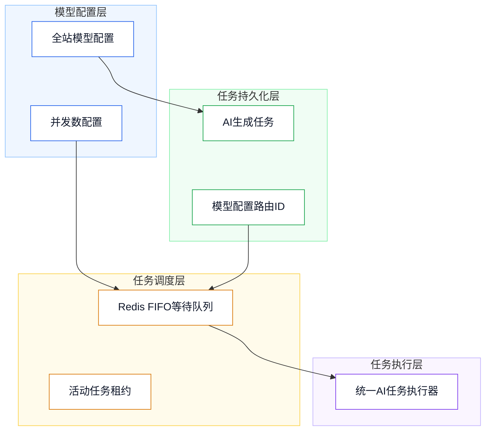

# 后端数据库说明（已实现）

## 剧本创作（V32）

剧本正式数据采用关系模型；只有不可变版本快照和待确认 AI 草稿使用 `JSONB`。项目级 `revision` 负责乐观锁，旧修订号提交返回数据冲突，不允许多标签页静默覆盖。

| 表 | 作用 | 关键索引或约束 |
| --- | --- | --- |
| `script_projects` | 项目概览、阶段、完成度、软删除与修订号 | `(user_id, status, updated_at DESC, id)`、用户+阶段、用户+内容形式 |
| `script_templates`、`script_template_sections` | 16 个内置模板及可编辑大纲骨架 | 启用状态+顺序、模板+结构段顺序 |
| `script_outline_sections`、`script_story_events` | 大纲结构段与关键剧情事件 | 项目+顺序；事件按分集、场次定位 |
| `script_characters`、`script_character_relations` | 人物文字设定与人物关系 | 项目+顺序；关系起点、终点索引 |
| `script_world_settings`、`script_world_items`、`script_locations` | 世界观基础、规则条目和地点文字设定 | 项目+类型+顺序、项目+地点顺序 |
| `script_episodes`、`script_scenes` | 分集摘要与场次 | 项目+分集顺序、分集+场次顺序、地点索引 |
| `script_scene_characters`、`script_blocks` | 场次人物与动作/对白/旁白/转场正文块 | 人物反查、场次+正文顺序、对白人物索引 |
| `script_versions` | 手动命名版本与 AI 修改前完整快照 | 项目+创建时间倒序；`snapshot_data` 必须为 JSON 对象 |
| `script_ai_drafts` | 待确认、已应用或已放弃的结构化 AI 草稿 | 项目+状态+时间、用户+时间；保存目标原内容用于冲突检查 |
| `script_analysis_reports`、`script_analysis_issues` | 小说改编一致性分析报告及具体问题锚点 | 项目+时间、报告+问题顺序 |

正式实体使用不超过 64 字符的稳定标识。人物和地点仍被场次或对白引用时禁止删除；场次和正文块保存采用稳定标识更新，只有请求中明确缺失的实体才会删除。

V39 移除 `script_projects` 的 `selling_points` 和 `target_audience` 字段，故事概览不再收集核心卖点和目标受众。

V52 为 `script_blocks` 增加 `origin` 字段（`original` 原著事实 / `adapted` AI 改编创作）。此前提示词要求把「【改编创作】」写在正文 `content` 里，标记会随正文流入分集工作台与后续配音、成片链路，且实测半数以上正文块都被标注而失去区分度；改为结构化字段承载，迁移同时摘除了存量正文里的标记并把来源记为 `adapted`。

V53 新增 `episode_bodies_pricing`（`model_config_id` 主键、`credits`、`revision`）：分集正文生成按文本模型配置「每生成一集的积分」。此前单价直接取模型自身的 `credit_cost`，管理员无法针对这一步单独定价。未配置的模型不参与报价。

完成度固定为：故事概览 20%、大纲 20%、人物/世界观/地点 20%、已完成集数占目标集数比例 40%。阶段由正式内容自动推导为 `idea`、`outline`、`writing`、`completed` 或 `production`。

---

## 密码重置

### `users`

| 字段 | 类型 | 说明 |
| --- | --- | --- |
| `token_version` | `INTEGER` | 登录令牌版本；密码重置成功后递增，令牌版本不一致的既有登录令牌将失效。 |

### `password_reset_tokens`

| 字段 | 类型 | 说明 |
| --- | --- | --- |
| `user_id` | `BIGINT` | 用户 ID，同时为主键，每名用户仅保留最新一条密码重置令牌。 |
| `token_hash` | `VARCHAR(64)` | 一次性重置令牌的 SHA-256 哈希，唯一且不保存明文。 |
| `expires_at` | `TIMESTAMPTZ` | 重置链接过期时间。 |
| `used_at` | `TIMESTAMPTZ` | 链接使用或因邮件发送失败而失效的时间。 |
| `created_at` | `TIMESTAMPTZ` | 最新重置链接创建时间。 |
| `updated_at` | `TIMESTAMPTZ` | 记录更新时间。 |

---

## 邀请注册奖励

### `users`

| 字段 | 类型 | 说明 |
| --- | --- | --- |
| `invitation_code` | `VARCHAR(16)` | 用户唯一邀请码，创建用户时由服务端安全随机生成，长期有效并建立唯一约束。 |
| `invited_by_user_id` | `BIGINT` | 邀请人用户 ID，关联 `users.id`；无邀请注册时为空。 |

### `platform_credit_settings`

| 字段 | 类型 | 说明 |
| --- | --- | --- |
| `invitation_reward_credits` | `INTEGER` | 每名受邀请新用户注册后发给邀请人的积分，默认 `0` 且不得小于 `0`。 |

### `user_credit_transactions`

| 字段 | 类型 | 说明 |
| --- | --- | --- |
| `transaction_type` | `VARCHAR(30)` | 新增 `invitation_reward` 邀请奖励类型。 |
| `invited_user_id` | `BIGINT` | 邀请奖励关联的被邀请新用户 ID；通过部分唯一索引保证每名新用户最多产生一条邀请奖励流水。 |

配置为 `0` 时仅保留 `users.invited_by_user_id` 邀请关系，不修改余额，也不创建零金额积分流水。

---

## 1、设计目标

- 目标：支持图像、视频模型按全站同一模型配置同时执行请求数量，并保证超额任务顺序排队。
- 约束：并发数最小为 `1`；任务必须保留创建时使用的模型配置 ID，重启后不得改投其他模型队列。
- 目标：支持画布中多个已持久化视频按用户排序异步合成为单个 MP4 文件。
- 约束：合成任务不使用 AI 模型、不占用模型并发额度、不扣积分；单次最少 2 段、最多 20 段，源视频总时长最多 10 分钟。
- 目标：支持运营维护图片和视频生成风格的封面与分类，并向用户侧风格库提供视觉元数据。
- 约束：历史 `GenerationStyleSnapshot` 只保存生成语义字段，不保存封面和分类，保证历史任务可独立重生成。
- 目标：支持统一主 Agent 按用户和入口类型串行执行，图片、视频和画布入口互不阻塞。
- 约束：`imagePage`、`videoPage`、`canvas` 每个用户分区固定同时运行 `1` 个请求；排队记录服务重启后恢复，失去活动租约的运行记录仅中断不重放。

## 2、总体架构

- 架构说明：`platform_ai_model_configs` 保存模型同时并发数；`ai_generation_tasks` 保存模型配置 ID；Redis 以模型配置 ID 作为队列分区键执行并发控制。
- 主 Agent 调度使用 `creation_agent_request` 保存完整请求快照；Redis 以 `{user_id:entry_source}` 为 FIFO 分区键并持有单槽活动租约，SSE 事件通过按用户的 Redis Pub/Sub 通道转发。



## 3、技术选型

- PostgreSQL：保存模型配置和任务恢复路由信息。
- Redis：保存按模型分区的 FIFO 等待队列和活动任务租约。
- FFmpeg / FFprobe：服务端探测视频元数据并统一转码为 H.264 视频、AAC 音频的 MP4 成片。

## 4、数据库设计

### `platform_ai_model_configs`

| 字段 | 类型 | 说明 |
| --- | --- | --- |
| `request_concurrency` | `INTEGER` | 模型同时执行请求数量，最小值为 `1`，默认值为 `1`。 |
| `convert_image_size_to_pixels` | `BOOLEAN` | 图像模型是否将 `size` 比例转换为像素尺寸，默认 `false`，普通模型和自定义模型共用。开启后按模型的 `image_size_mappings` 精确查表，未指定档位默认2K；不再按长边或公式计算。已给定像素尺寸原样使用，模板及自定义JSON中手写的size保持优先。接口字段为 `convertImageSizeToPixels`。 |
| `image_size_mappings` | `JSONB` | 图像模型的尺寸映射，形如 `{"1:1":{"1K":"1024x1024","2K":"2048x2048","4K":"2880x2880"}}`，接口字段为 `imageSizeMappings`。SQL空值或JSON null使用系统默认表；自定义表独立保存，不与默认表逐项合并，未填档位明确报错。文本、视频模型不使用。 |
| `custom_body_parameters` | `JSONB` | 模型 JSON POST 请求的自定义请求体参数，顶层必须为 JSON 对象，默认 `{}`。 |
| `video_billing_configuration` | `JSONB` | 视频模型分档计费配置，包含唯一计费方式、最短生成秒数，以及文生视频、图生视频、全能参考三个模式各自的 `Auto/480p/720p/768p/1080p/2k/4k` 单价；空价格表示该模式和分辨率不可用。 |
| `image_billing_configuration` | `JSONB` | 图片模型的分辨率价目表，形如 `{"resolutionPrices":{"1K":1,"2K":4,"4K":9}}`，接口字段为 `imageBillingConfiguration`。配置后按请求 `parameters.resolution`（缺省或 `auto` 按 `2K`）取价，请求档位未配置时直接报错；整列为空表示沿用模型 `credit_cost` 单价。文本、视频模型不使用。 |
| `display_name` | `VARCHAR(255)` | 模型展示名称，为空或与真实模型名相同时展示真实模型名，仅影响展示不影响调用。 |
| `model_icon` | `VARCHAR(64)` | 模型展示图标标识，为空时按模型名或渠道自动匹配，仅影响展示不影响调用。 |
| `is_custom_model` | `BOOLEAN` | 是否启用自定义模型调用，独立于渠道调用格式，仅图片/视频模型支持，默认 `false`。 |
| `custom_model_config` | `JSONB` | 自定义模型配置，按图片能力（`text-to-image`、`image-to-image`）或视频模式（`text-to-video`、`image-to-video`、`reference-to-video`、`first-last-frame-to-video`）分组；每组含请求路径（以 `/` 开头，与渠道 Base URL 拼接，支持 `{{taskId}}` 占位符）、请求方法（`GET`/`POST`，默认 POST）、请求模型名称、请求示例 JSON 模板（支持 `{{prompt}}`、`{{model}}`、`{{references}}`、`{{videoReferences}}`、`{{audioReferences}}`、`{{size}}` 等占位符）、AI 构造请求体提示词（可选，配置后由 Agent 按提示词与本次参数生成请求体，替代模板拼接）、响应示例、结果路径（如 `data.image.url`）；视频模式额外含查询路径（支持 `{{taskId}}`）、查询方法、查询请求示例、AI 构造查询请求体提示词、查询响应示例、查询结果路径，用于异步任务轮询，轮询间隔统一使用 `AI_TASK_POLLING_INTERVAL_SECONDS` 配置。 每个启用的视频模式必须配置 `videoGenerationConstraints`：`minimumDurationSeconds`、`maximumDurationSeconds`（正整数秒）、`minimumImageCount`、`maximumImageCount`（非负整数，最小值不超过最大值）、`supportedAspectRatios`（至少一项：`16:9`、`9:16`、`1:1`、`4:3`、`3:4`、`21:9`、`auto`）；全能参考另需 `maximumVideoCount`、`maximumAudioCount`（非负整数），图片上限复用 `maximumImageCount`。文生视频图片范围固定为 0，首尾帧固定为 2，图生视频最少 1 张；全能参考至少允许一类素材且使用时至少提供一个素材，音频开关关闭时上限 0、开启时为正整数。有效最短时长取模式最短时长与计费最短时长的较大值，不能超过最长时长；缺失限制不自动补值。视频任务 `parameters.size` 使用比例字符串，自动比例为 `auto`。 |

#### 图像模型默认尺寸表

开启尺寸转换后使用下表，管理员可为每个图像模型修改或恢复默认值，未配置的组合不会自动推算。

| 画幅比例 | 1K | 2K | 4K |
| --- | --- | --- | --- |
| 1:1 | 1024x1024 | 2048x2048 | 2880x2880 |
| 1:2 | 512x1024 | 1024x2048 | 1648x3296 |
| 2:1 | 1024x512 | 2048x1024 | 3296x1648 |
| 9:16 | 720x1280 | 1152x2048 | 2160x3840 |
| 16:9 | 1280x720 | 2048x1152 | 3840x2160 |
| 3:4 | 864x1152 | 1536x2048 | 2448x3264 |
| 4:3 | 1152x864 | 2048x1536 | 3264x2448 |
| 3:2 | 1536x1024 | 2400x1600 | 3456x2304 |
| 2:3 | 1024x1536 | 1600x2400 | 2304x3456 |
| 5:4 | 1120x896 | 2240x1792 | 3200x2560 |
| 4:5 | 896x1120 | 1792x2240 | 2560x3200 |
| 21:9 | 1344x576 | 2016x864 | 3808x1632 |
| 9:21 | 576x1344 | 864x2016 | 1632x3808 |


### `ai_generation_tasks`

| 字段 | 类型 | 说明 |
| --- | --- | --- |
| `model_config_id` | `VARCHAR(64)` | 创建任务使用的全站模型配置业务 ID，用于任务恢复时进入正确的模型队列。 |
| `error_message_key` | `VARCHAR(180)` | 与语言无关的系统消息键，空值表示无系统提示。 |
| `error_message_arguments` | `JSONB` | 消息插值参数数组；原始诊断保留在 `error_message` 中。 |

### `video_composition_tasks`

| 字段 | 类型 | 说明 |
| --- | --- | --- |
| `id` | `VARCHAR(64)` | 视频合成任务 ID，主键。 |
| `user_id` | `BIGINT` | 任务所属用户 ID，外键关联 `users.id`。 |
| `status` | `VARCHAR(20)` | 任务状态：`pending`、`running`、`succeeded`、`failed`、`canceled`。 |
| `progress` | `INTEGER` | 当前进度，取值范围为 `0` 至 `100`。 |
| `source_storage_keys` | `JSONB` | 按最终合成顺序固化的源视频媒体存储键数组。 |
| `task_type` | `VARCHAR(32)` | `canvasComposition` 画布拼接或 `storyboardExport` 分镜导出。 |
| `project_id` | `VARCHAR(64)` | 分镜导出所属漫剧项目 ID，画布任务为空。 |
| `input_snapshot` | `JSONB` | 分镜导出时冻结的镜头、文字和声音时间轴。 |
| `result_data` | `JSONB` | 成片的存储键、URL、MIME、尺寸、字节数和时长。 |
| `error_message` | `TEXT` | 下载、探测、转码或上传失败时的中文原始诊断。 |
| `error_message_key` | `VARCHAR(180)` | 与语言无关的系统消息键，空值表示无系统提示。 |
| `error_message_arguments` | `JSONB` | 消息插值参数数组；原始诊断保留在 `error_message` 中。 |
| `started_at` | `TIMESTAMPTZ` | 实际开始处理时间。 |
| `completed_at` | `TIMESTAMPTZ` | 成功、失败或取消的完成时间。 |
| `created_at` | `TIMESTAMPTZ` | 任务创建时间。 |
| `updated_at` | `TIMESTAMPTZ` | 状态或进度最后更新时间。 |

### `creation_agent_request`

| 字段 | 类型 | 说明 |
| --- | --- | --- |
| `id` | `VARCHAR(64)` | 主 Agent 请求 ID，主键。 |
| `user_id` | `BIGINT` | 请求所属用户 ID，关联 `users.id`。 |
| `session_id` | `VARCHAR(64)` | 关联 Agent 会话 ID，关联 `agent_session.id`。 |
| `entry_source` | `VARCHAR(20)` | 入口来源：`imagePage`、`videoPage`、`canvas`。 |
| `request_data` | `JSONB` | 完整 `AgentChatRequest` 请求快照。 |
| `status` | `VARCHAR(20)` | `queued`、`running`、`success`、`failed`、`canceled`、`interrupted`。 |
| `plan_id` | `VARCHAR(64)` | 主 Agent 创建后的创作计划 ID，可为空。 |
| `task_ids` | `JSONB` | 已创建底层 AI 任务 ID 数组，用于精确取消和重启中断。 |
| `error_message` | `TEXT` | 失败、取消或中断的中文诊断。 |
| `error_message_key` | `VARCHAR(180)` | 与语言无关的系统消息键，空值表示无系统提示。 |
| `error_message_arguments` | `JSONB` | 消息插值参数数组；原始诊断保留在 `error_message` 中。 |
| `started_at` | `TIMESTAMPTZ` | 调度器领取后的开始时间。 |
| `completed_at` | `TIMESTAMPTZ` | 进入终态的完成时间。 |
| `created_at` | `TIMESTAMPTZ` | 请求创建时间。 |
| `updated_at` | `TIMESTAMPTZ` | 记录最后更新时间。 |

### `generation_styles`

| 字段 | 类型 | 说明 |
| --- | --- | --- |
| `cover_url` | `TEXT` | 风格封面的公开访问地址；旧记录默认空字符串，用户侧使用中性默认封面展示。 |
| `category` | `VARCHAR(100)` | 运营维护的风格分类；旧记录默认空字符串，用户侧不生成分类筛选标签。 |

```sql
ALTER TABLE platform_ai_model_configs
    ADD COLUMN request_concurrency INTEGER NOT NULL DEFAULT 1,
    ADD CONSTRAINT ck_platform_ai_model_configs_request_concurrency CHECK (request_concurrency >= 1);

COMMENT ON COLUMN platform_ai_model_configs.request_concurrency IS '模型同时执行请求数量，最小值为1';

ALTER TABLE ai_generation_tasks
    ADD COLUMN model_config_id VARCHAR(64);

COMMENT ON COLUMN ai_generation_tasks.model_config_id IS '创建任务时使用的全站模型配置业务ID，用于模型队列恢复';

CREATE INDEX idx_ai_generation_tasks_model_config_active
    ON ai_generation_tasks(model_config_id)
    WHERE status IN ('pending', 'running');
```

```sql
CREATE TABLE video_composition_tasks (
    id VARCHAR(64) PRIMARY KEY,
    user_id BIGINT NOT NULL REFERENCES users(id),
    status VARCHAR(20) NOT NULL DEFAULT 'pending',
    progress INTEGER NOT NULL DEFAULT 0 CHECK (progress >= 0 AND progress <= 100),
    source_storage_keys JSONB NOT NULL,
    result_data JSONB NOT NULL DEFAULT '{}'::jsonb,
    error_message TEXT NOT NULL DEFAULT '',
    started_at TIMESTAMPTZ,
    completed_at TIMESTAMPTZ,
    created_at TIMESTAMPTZ NOT NULL DEFAULT CURRENT_TIMESTAMP,
    updated_at TIMESTAMPTZ NOT NULL DEFAULT CURRENT_TIMESTAMP
);

COMMENT ON TABLE video_composition_tasks IS '画布视频合成异步任务表';
COMMENT ON COLUMN video_composition_tasks.id IS '视频合成任务ID';
COMMENT ON COLUMN video_composition_tasks.user_id IS '任务所属用户ID';
COMMENT ON COLUMN video_composition_tasks.status IS '任务状态：pending等待，running执行中，succeeded成功，failed失败，canceled已取消';
COMMENT ON COLUMN video_composition_tasks.progress IS '任务进度，范围0-100';
COMMENT ON COLUMN video_composition_tasks.source_storage_keys IS '按合成顺序保存的源视频媒体存储键数组';
COMMENT ON COLUMN video_composition_tasks.result_data IS '合成结果媒体JSON数据';
COMMENT ON COLUMN video_composition_tasks.error_message IS '失败或取消原因';
COMMENT ON COLUMN video_composition_tasks.started_at IS '任务开始执行时间';
COMMENT ON COLUMN video_composition_tasks.completed_at IS '任务完成时间';
COMMENT ON COLUMN video_composition_tasks.created_at IS '任务创建时间';
COMMENT ON COLUMN video_composition_tasks.updated_at IS '任务更新时间';

CREATE INDEX idx_video_composition_tasks_user_updated
    ON video_composition_tasks(user_id, updated_at DESC);

CREATE INDEX idx_video_composition_tasks_recovery
    ON video_composition_tasks(status, created_at, id)
    WHERE status IN ('pending', 'running');
```

V37 为该表增加 `task_type`、`project_id`、`input_snapshot`，并建立 `(user_id, project_id, created_at DESC, id DESC)` 的分镜导出任务索引；旧迁移不修改。

```sql
ALTER TABLE generation_styles
    ADD COLUMN cover_url TEXT NOT NULL DEFAULT '',
    ADD COLUMN category VARCHAR(100) NOT NULL DEFAULT '';

COMMENT ON COLUMN generation_styles.cover_url IS '风格封面公开访问地址';
COMMENT ON COLUMN generation_styles.category IS '风格分类';
```

### `skills`

| 字段 | 类型 | 说明 |
| --- | --- | --- |
| `id` | `BIGINT` | 技能 ID，主键自增。 |
| `name` | `VARCHAR(100)` | 技能名称。 |
| `description` | `TEXT` | 技能简介，展示在用户侧选择面板。 |
| `target_type` | `VARCHAR(20)` | 适用生成类型：`image` 图片、`video` 视频、`canvasSettingGraph` 画布设定图。 |
| `system_prompt` | `TEXT` | 技能流程系统提示词，驱动主 Agent 引导式多轮对话。 |
| `aspect_ratio` | `VARCHAR(16)` | 技能默认生成比例，例如 `16:9`、`9:16`；图片和视频生成时优先使用。 |
| `cover_url` | `TEXT` | 技能封面公开访问地址。 |
| `status` | `INTEGER` | 状态：`1` 启用，`0` 停用。 |
| `sort_order` | `INTEGER` | 排序值，越小越靠前。 |
| `created_at` | `TIMESTAMPTZ` | 创建时间。 |
| `updated_at` | `TIMESTAMPTZ` | 更新时间。 |
| `deleted_at` | `TIMESTAMPTZ` | 软删除时间。 |

```sql
CREATE TABLE skills (
    id BIGINT GENERATED BY DEFAULT AS IDENTITY PRIMARY KEY,
    name VARCHAR(100) NOT NULL,
    description TEXT NOT NULL DEFAULT '',
    target_type VARCHAR(20) NOT NULL,
    system_prompt TEXT NOT NULL,
    aspect_ratio VARCHAR(16) NOT NULL DEFAULT '16:9',
    cover_url TEXT NOT NULL DEFAULT '',
    status INTEGER NOT NULL DEFAULT 1,
    sort_order INTEGER NOT NULL DEFAULT 1000,
    created_at TIMESTAMPTZ NOT NULL DEFAULT CURRENT_TIMESTAMP,
    updated_at TIMESTAMPTZ NOT NULL DEFAULT CURRENT_TIMESTAMP,
    deleted_at TIMESTAMPTZ,
    CONSTRAINT ck_skills_target_type CHECK (target_type IN ('image', 'video', 'canvasSettingGraph')),
    CONSTRAINT ck_skills_status CHECK (status IN (0, 1)),
    CONSTRAINT ck_skills_aspect_ratio CHECK (aspect_ratio ~ '^[0-9]+:[0-9]+$')
);

COMMENT ON TABLE skills IS '图片、视频和画布设定图生成技能表';
COMMENT ON COLUMN skills.id IS '技能ID';
COMMENT ON COLUMN skills.name IS '技能名称';
COMMENT ON COLUMN skills.description IS '技能简介，展示在用户侧选择面板';
COMMENT ON COLUMN skills.target_type IS '适用生成类型：image图片，video视频，canvasSettingGraph画布设定图';
COMMENT ON COLUMN skills.system_prompt IS '技能流程系统提示词，驱动主Agent引导式多轮对话';
COMMENT ON COLUMN skills.aspect_ratio IS '技能默认生成比例，例如16:9、9:16；图片和视频生成时优先使用';
COMMENT ON COLUMN skills.cover_url IS '技能封面公开访问地址';
COMMENT ON COLUMN skills.status IS '状态：1启用，0停用';
COMMENT ON COLUMN skills.sort_order IS '排序值，越小越靠前';
COMMENT ON COLUMN skills.created_at IS '创建时间';
COMMENT ON COLUMN skills.updated_at IS '更新时间';
COMMENT ON COLUMN skills.deleted_at IS '软删除时间';

CREATE INDEX idx_skills_type_status_sort
    ON skills(target_type, status, sort_order, id)
    WHERE deleted_at IS NULL;
CREATE INDEX idx_skills_deleted_at
    ON skills(deleted_at);
```

迁移 `V24__Add_Canvas_Setting_Graph_Skills.sql` 会初始化四条启用的 `canvasSettingGraph` 技能：**角色脸部三视图、角色设定图、角色三视图、场景设定图**。迁移 `V25__Add_Skill_Aspect_Ratio.sql` 为技能增加 `aspect_ratio`，默认值为 `16:9`；节点或图片/视频页面选择技能后，优先使用该比例。迁移 `V26__Update_Character_Three_View_Skill.sql` 同步更新四条画布设定图技能的提示词：**角色三视图**按正面、左侧面、背面生成全身正交三视图，**场景设定图、角色设定图、角色脸部三视图**分别强化场景、角色设计板和脸部三视图要求，并统一保留用户原始描述、上游引用、尺寸询问与现有节点生成约束。每条技能的 `system_prompt` 保存中文多步骤流程、缺项询问规则、提示词组装要求及最终必须调用 `canvas_run_generation` 的约束，节点创建时会将其快照持久化。

### 视频技能工作流

```sql
ALTER TABLE agent_plan ADD COLUMN workflow_type VARCHAR(100) NOT NULL DEFAULT '';
ALTER TABLE agent_plan_task ADD COLUMN task_role VARCHAR(100) NOT NULL DEFAULT '';

CREATE TABLE video_workflow_context (
    id VARCHAR(64) PRIMARY KEY,
    user_id BIGINT NOT NULL REFERENCES users(id),
    session_id VARCHAR(64) NOT NULL REFERENCES agent_session(id) ON DELETE CASCADE,
    workflow_type VARCHAR(100) NOT NULL,
    skill_snapshot JSONB NOT NULL DEFAULT '{}'::jsonb,
    original_request TEXT NOT NULL,
    clarification_question TEXT NOT NULL DEFAULT '',
    answers JSONB NOT NULL DEFAULT '[]'::jsonb,
    drafted_prompts JSONB NOT NULL DEFAULT '{}'::jsonb,
    creation_settings JSONB NOT NULL DEFAULT '{}'::jsonb,
    status VARCHAR(30) NOT NULL,
    context_version INTEGER NOT NULL DEFAULT 1,
    created_at TIMESTAMPTZ NOT NULL DEFAULT CURRENT_TIMESTAMP,
    updated_at TIMESTAMPTZ NOT NULL DEFAULT CURRENT_TIMESTAMP,
    CONSTRAINT ck_video_workflow_context_status CHECK (status IN ('clarifying', 'pending_confirm', 'planned', 'completed', 'failed', 'canceled'))
);
```

`agent_plan.workflow_type` 为空时表示普通计划；`agent_plan_task.task_role` 由工作流定义解释。`video_workflow_context` 保存技能快照、原始需求、澄清问答与页面设置，确保后续回复继续原工作流而不会重新被解释成普通视频请求。状态流转：`clarifying`（多轮对话理解意图）→ `pending_confirm`（助手已起草提示词，等待用户确认）→ `planned`（用户确认，开始执行）→ 终态 `completed`/`failed`/`canceled`。`drafted_prompts` 保存助手起草的首帧、尾帧和视频提示词，用户确认后由工作流定义生成任务。

```sql
CREATE TABLE creation_agent_request (
    id VARCHAR(64) PRIMARY KEY,
    user_id BIGINT NOT NULL REFERENCES users(id),
    session_id VARCHAR(64) NOT NULL REFERENCES agent_session(id) ON DELETE CASCADE,
    entry_source VARCHAR(20) NOT NULL,
    request_data JSONB NOT NULL,
    status VARCHAR(20) NOT NULL DEFAULT 'queued',
    plan_id VARCHAR(64) REFERENCES agent_plan(id) ON DELETE SET NULL,
    task_ids JSONB NOT NULL DEFAULT '[]'::jsonb,
    error_message TEXT NOT NULL DEFAULT '',
    started_at TIMESTAMPTZ,
    completed_at TIMESTAMPTZ,
    created_at TIMESTAMPTZ NOT NULL DEFAULT CURRENT_TIMESTAMP,
    updated_at TIMESTAMPTZ NOT NULL DEFAULT CURRENT_TIMESTAMP,
    CONSTRAINT ck_creation_agent_request_entry_source CHECK (entry_source IN ('imagePage', 'videoPage', 'canvas')),
    CONSTRAINT ck_creation_agent_request_status CHECK (status IN ('queued', 'running', 'success', 'failed', 'canceled', 'interrupted'))
);

COMMENT ON TABLE creation_agent_request IS '统一主Agent请求队列持久化记录表';
COMMENT ON COLUMN creation_agent_request.id IS '主Agent请求ID';
COMMENT ON COLUMN creation_agent_request.user_id IS '请求所属用户ID';
COMMENT ON COLUMN creation_agent_request.session_id IS '关联Agent会话ID';
COMMENT ON COLUMN creation_agent_request.entry_source IS '入口来源：imagePage、videoPage、canvas';
COMMENT ON COLUMN creation_agent_request.request_data IS '完整AgentChatRequest请求快照JSON';
COMMENT ON COLUMN creation_agent_request.status IS '请求状态：queued排队、running运行、success成功、failed失败、canceled取消、interrupted重启中断';
COMMENT ON COLUMN creation_agent_request.plan_id IS '主Agent创建后的创作计划ID';
COMMENT ON COLUMN creation_agent_request.task_ids IS '已创建底层AI任务ID数组';
COMMENT ON COLUMN creation_agent_request.error_message IS '失败、取消或中断原因';
COMMENT ON COLUMN creation_agent_request.started_at IS '请求被领取并开始执行的时间';
COMMENT ON COLUMN creation_agent_request.completed_at IS '请求进入终态的时间';
COMMENT ON COLUMN creation_agent_request.created_at IS '请求创建时间';
COMMENT ON COLUMN creation_agent_request.updated_at IS '请求最后更新时间';

CREATE INDEX idx_creation_agent_request_recovery
    ON creation_agent_request(status, created_at ASC, id ASC)
    WHERE status IN ('queued', 'running');

CREATE INDEX idx_creation_agent_request_user_entry_created
    ON creation_agent_request(user_id, entry_source, created_at ASC, id ASC);

CREATE INDEX idx_creation_agent_request_session_created
    ON creation_agent_request(session_id, created_at DESC);
```

### `api_logs`

| 字段 | 类型 | 说明 |
| --- | --- | --- |
| `id` | `BIGSERIAL` | 主键，自增。 |
| `http_method` | `VARCHAR(10)` | HTTP 方法（GET/POST 等，大写）。 |
| `request_path` | `TEXT` | 请求地址（路径+查询参数已脱敏）。 |
| `client_ip` | `VARCHAR(64)` | 访问者客户端 IP（含 X-Forwarded-For 解析）。 |
| `user_id` | `BIGINT` | 访问用户 ID，未登录为 NULL；用户删除时置空。 |
| `status_code` | `INTEGER` | HTTP 响应状态码。 |
| `success` | `BOOLEAN` | 是否成功（status_code < 400）。 |
| `has_error` | `BOOLEAN` | 是否有错误（status_code >= 400，等价于 NOT success）。 |
| `error_content` | `TEXT` | 失败响应正文（截断，最长 20000 字符）；成功为 NULL。 |
| `request_body` | `TEXT` | 请求体/参数（脱敏并截断，最长 20000 字符；multipart 为摘要）。 |
| `duration_ms` | `INTEGER` | 请求耗时（毫秒）。 |
| `created_at` | `TIMESTAMPTZ` | 创建时间，用于保留期清理与默认倒序。 |

- 由 `ApiAccessLogWebFilter` 在每次 `/api/**` 请求响应完成后异步落库，仅记录元数据；失败响应（>=400）才会缓冲并存储响应正文。
- SSE 长连接与文件上传仅记录元数据，不缓冲响应体。
- 保留期：由 `ApiLogRetentionScheduler` 每日 03:00 清理 30 天前的记录。

```sql
CREATE TABLE api_logs (
    id BIGSERIAL PRIMARY KEY,
    http_method VARCHAR(10) NOT NULL,
    request_path TEXT NOT NULL,
    client_ip VARCHAR(64) NOT NULL,
    user_id BIGINT NULL,
    status_code INTEGER NOT NULL,
    success BOOLEAN NOT NULL,
    has_error BOOLEAN NOT NULL,
    error_content TEXT NULL,
    request_body TEXT NULL,
    duration_ms INTEGER NOT NULL,
    created_at TIMESTAMPTZ NOT NULL DEFAULT CURRENT_TIMESTAMP,
    CONSTRAINT fk_api_logs_user FOREIGN KEY (user_id) REFERENCES users (id) ON DELETE SET NULL
);

CREATE INDEX idx_api_logs_created_at ON api_logs (created_at DESC);
CREATE INDEX idx_api_logs_user_id ON api_logs (user_id);
CREATE INDEX idx_api_logs_status_code ON api_logs (status_code);
```

## 5、接口设计

- 复用既有模型配置接口：`/config/model/listModelConfigs`、`/config/model/createModelConfig`、`/config/model/updateModelConfig`。
- 模型配置响应和创建、更新请求新增 `requestConcurrency` 字段。
- `POST /api/v1/ai/video/composeVideo`：创建视频合成任务，请求体为按顺序排列的 `sourceStorageKeys`。
- `POST /api/v1/ai/video/getCompositionTask`：查询当前用户的视频合成任务状态与成片媒体。
- `POST /api/v1/ai/video/cancelCompositionTask`：取消当前用户尚未结束的视频合成任务。
- `POST /api/v1/ai/agent/chat`：返回本次 `sessionId`、`requestId` 和 `queued` 或 `running` 状态。
- `POST /api/v1/ai/agent/cancelChat`：按 `requestId` 精确取消排队或运行中的统一主 Agent 请求。
- `GET /api/v1/style/listStyles`：返回当前类型的启用风格，包含 `coverUrl`、`category`，不改变风格 ID 和历史快照语义。
- `GET /api/v1/admin/style/listStyles`、`POST /api/v1/admin/style/createStyle`、`POST /api/v1/admin/style/updateStyle`：管理端维护风格封面与分类；创建和更新请求均要求非空 `coverUrl`、`category`。
- `GET /api/v1/skill/listSkills?targetType=image`：返回当前生成类型的启用技能列表（含 `id`、`name`、`description`、`targetType`、`coverUrl`、`aspectRatio`）。
- `GET /api/v1/admin/skill/listSkills`、`POST /api/v1/admin/skill/createSkill`、`POST /api/v1/admin/skill/updateSkill`、`POST /api/v1/admin/skill/updateSkillStatus`、`POST /api/v1/admin/skill/deleteSkills`：管理端维护技能（创建/更新要求非空 `name`、`system_prompt`，支持 `aspectRatio`，`targetType` 支持 `image`、`video`、`canvasSettingGraph`）。

## 6、测试与验收

- 并发数为 `1` 时，同一模型任务顺序执行。
- 并发数为 `3` 时，同一模型最多同时执行三个任务。
- 调高并发数后立即补位，调低时不终止已运行任务。
- 视频合成仅接受当前用户已持久化的视频媒体；重复媒体、少于 2 段、超过 20 段或总时长超过 10 分钟均会失败。
- 服务实例异常后，未完成合成任务会根据 Redis 活动任务租约重新进入 FIFO 队列；同一任务不会被重复领取。
- 管理端创建、更新风格时，封面与分类均会持久化并返回到用户侧风格列表。
- 历史空封面、空分类记录仍可显示并用于历史重生成；普通生成最多选择 1 个风格，历史重生成最多保留 3 个风格快照。
- 同一用户的图片请求按提交顺序串行，视频和画布请求可并行；不同用户的相同入口请求互不阻塞。
- 取消排队请求不会影响运行请求和其他入口分区；取消运行请求会继续取消关联计划及已创建的底层任务。
- 服务重启后 `queued` 请求按创建顺序恢复；没有有效活动租约的 `running` 请求标记为 `interrupted`，不会重复执行或重复写画布。

## 7、部署说明

- 发布时由 Flyway 执行至 `V20__Add_Skills.sql`。
- 服务新增每日 03:00 清理 30 天前 `api_logs` 记录的定时任务（依赖 `@EnableScheduling`）。
- Redis 必须可用；模型队列、视频合成队列和统一主 Agent 队列均使用各自的 Redis 活动租约配置。
- 服务端镜像已安装 `ffmpeg` 与 `ffprobe`；可通过 `AI_VIDEO_COMPOSITION_FFMPEG_EXECUTABLE`、`AI_VIDEO_COMPOSITION_FFPROBE_EXECUTABLE` 覆盖二进制路径。

## 8、附录说明

- 文档状态：已实现。

## 9、V33 漫剧生产工作台

`V33__Add_Comic_Drama_Production.sql` 在共享 `script_projects` 之上增加漫剧下游生产模型。`comic_drama_projects.script_project_id` 同时是主键和剧本项目外键，因此剧本始终只有一份；人物、地点、分集、场次与正文块的下游来源标识不建立限制删除的外键，保证剧本替换和版本恢复不会被漫剧数据阻塞。

| 表 | 用途 | 关键索引或约束 |
| --- | --- | --- |
| `comic_drama_projects` | 一对一漫剧项目、用户归属、生产状态和工作区乐观锁 | 用户更新时间索引、`script_project_id` 主键 |
| `comic_drama_project_settings` | 项目类型、时长、横竖屏、比例、视觉风格和目标平台 | 项目一对一主键 |
| `comic_drama_assets` | 人物、场景与道具视觉资产 | 项目+类型、来源实体索引 |
| `comic_drama_asset_versions` | 服装、年龄、时间、天气和剧情状态等多版本 | 资产+创建时间索引、实体修订号 |
| `comic_drama_shot_drafts` | AI自动拆镜头的待确认草稿 | 项目+状态+创建时间索引 |
| `comic_drama_shots` | 关系化正式镜头清单 | 项目排序、来源场次、制作状态索引 |
| `comic_drama_shot_asset_versions` | 镜头实际引用的具体资产版本 | 镜头+资产版本复合主键 |
| `comic_drama_prompt_versions` | AI或人工提示词不可变版本 | 镜头+版本号唯一约束 |
| `comic_drama_media_results` | 图片、视频、音频与合成任务及输入快照 | 目标、任务ID索引；每目标每媒体类型只允许一个采用版本 |
| `comic_drama_change_impacts` | 上游剧本变化产生的待更新影响 | 项目+状态+创建时间索引 |
| `comic_drama_canvas_bindings` | 结构化实体与无限画布节点绑定 | 项目+画布+节点唯一约束 |
| `comic_drama_voice_tracks` | P1对白、旁白、环境音、音效与音乐轨 | 项目+镜头索引、实体修订号 |
| `comic_drama_batch_tasks` | P1批量生产范围、报价、确认和进度统计 | 项目时间、用户状态索引 |

所有项目读写先按 `comic_drama_projects.user_id` 校验当前用户归属。项目级写操作使用 `expectedRevision` 更新 `comic_drama_projects.revision`；资产、资产版本、镜头和声音轨同时保留各自修订号。视频任务创建后只记录底层 `task_id`、输入快照和真实排队状态，不会在底层任务完成前写成 `completed`。

上游剧本保存由独立 `ComicDramaImpactService` 单向标记影响，覆盖故事概览、人物、世界观、分集场次正文和版本恢复。该过程保留全部下游内容，只把镜头、资产、提示词、声音与已完成媒体标记为 `needsUpdate`，用户通过更新中心确认范围后再决定是否重新生成。

### V33 漫剧接口

- 项目与设置：`GET /api/v1/comicDrama/listProjects`、`POST /api/v1/comicDrama/getWorkspace`、`initializeProject`、`updateSettings`、`getReadiness`。
- 视觉资产：`listAssets`、`saveAsset`、`listAssetVersions`、`saveAssetVersion`。
- 镜头与提示词：`generateShotDraft`、`confirmShotDraft`、`listShots`、`saveShot`、`reorderShots`、`deleteShot`、`composePrompt`、`savePrompt`。
- 媒体生产：`estimateGeneration`、`createGenerationTask`、`listMedia`、`adoptMedia`。
- 联动与P1：`listImpacts`、`confirmUpdate`、`listVoiceTracks`、`saveVoiceTrack`、`listBatchTasks`、`createBatchTask`、`checkContinuity`。
- 无限画布：`listCanvasBindings`、`bindCanvas`。

## 10、V34 镜头草稿双修订基线

`V34__Add_Shot_Draft_Script_Revision.sql` 为 `comic_drama_shot_drafts` 新增 `base_script_revision`。镜头草稿生成时同时保存漫剧项目修订号 `base_project_revision` 和共享剧本修订号 `base_script_revision`。

确认镜头草稿时必须同时满足：

- 漫剧工作区当前修订号与 `base_project_revision` 一致，避免生产设置、视觉资产或镜头清单变化后继续应用旧草稿。
- 共享剧本当前修订号与 `base_script_revision` 一致，避免故事、分集、场次或正文变化后静默确认旧拆镜结果。

最终状态更新仍在写入正式镜头的同一事务内再次通过数据库子查询校验两条修订线；并发变化会使确认更新行数为零并回滚已追加镜头，不会形成部分写入。

## 11、V35 分镜多轨时间轴

`V35__Add_Comic_Drama_Timeline_Tracks.sql` 新增 `comic_drama_timeline_texts`，按项目绝对毫秒时间保存文字叠层及归一化画面位置，并建立项目与起点索引。`comic_drama_voice_tracks` 增加音频存储标识、原始时长、排期起点及源音频裁剪范围；未排期的声音条目仍可保留描述和已上传文件。新增 `listTimelineTexts`、`saveTimelineText`、`deleteTimelineText` 接口，工作区聚合响应增加 `timelineTexts`。文字与音频保存沿用项目修订号，文字和声音条目分别使用实体修订号。

同轨文字片段拖动换位使用 `/comicDrama/reorderTimelineTexts` 批量接口，在同一事务中校验最终时间区间、实体修订号并保存受影响片段，项目修订号只推进一次。

## 12、V36 文字轨道分层

`V36__Add_Comic_Drama_Text_Track_Lanes.sql` 为 `comic_drama_projects` 增加 `text_track_count`，范围为 1 至 3、默认 1；为 `comic_drama_timeline_texts` 增加从 0 开始的 `track_number`，并建立项目、轨道及时间组合索引。默认 0 号轨道不可删除。同一轨道的片段时间不得重叠，不同轨道允许重叠。保存文字时可顺序新增轨道；`deleteTextTrack` 删除指定新增轨道及片段，并将后续轨道编号前移。

`V38__Add_Storyboard_Text_Font_Family.sql` 为 `comic_drama_timeline_texts` 增加 `font_family`，使用固定字体目录标识；已有文字片段默认 `notoSansSc`，数据库约束限定七款随产品分发的免费字体。文字保存接口与分镜导出快照均保留该字段。


## 13、V40 原文导入与人工校对

`V40__Add_Script_Source_Import.sql` 新增导入原文层，与 V32 的正式剧本数据分离保存（见 ADR-006）。脚本创作阶段只写入本节四张表，不生成人物、Story Bible、分集或正式剧本场次。

| 表 | 作用 | 关键索引或约束 |
| --- | --- | --- |
| `script_source_documents` | 不可变原文件元信息与仅规范换行后的完整正文 | `project_id` 唯一；`(user_id, client_request_id)` 唯一用于上传幂等；单文件与单项目一条原文 |
| `script_source_sections` | 章节与场景结构投影，偏移基于规范化正文 | 自关联 `parent_id` 级联；`(document_id, parent_id, sort_order)` 与 `(document_id, start_offset, end_offset)` 索引 |
| `script_source_chunks` | 供后续分析使用的有序文本片段 | `(section_id, chunk_index)` 唯一保证重复解析幂等；`(document_id, start_offset)` 索引 |
| `script_source_import_tasks` | 解析任务状态、阶段、进度、失败原因与检查点 | `document_id` 唯一；`(status, updated_at)` 用于重启恢复扫描 |

约定：

- 数据库只保存对象存储配置标识 `storage_config_id` 与私有对象键 `object_key`，接口不返回原文件公开地址；原文件保持不可变，校对只修改结构投影。
- 所有位置使用规范化文本的 UTF-16 偏移，起点包含、终点不包含。片段按段落边界切分，`character_count` 为 UTF-16 字符数，不代表模型令牌数。
- 结构段标识由 `原文标识 + 解析下标` 推导，重复投递会命中主键冲突而不重复写入；`processed_sections` 记录已落库的顶层结构段数，服务重启后从检查点续跑。
- 上游规则未识别到标题时保存为单个 `needs_review` 结构段并写入 `warning`，由用户人工校对标题与边界。
- 校对操作（改名、拆分、合并）以 `expectedRevision` 更新 `script_source_documents.revision`，冲突返回 `DATA_CONFLICT`；拆分与合并会重建受影响结构段的片段。

### V40 原文接口

- 导入与进度：`POST /api/v1/script/source/uploadSource`、`getImportStatus`、`retryImport`。
- 读取：`getSourceTree`、`getSourceSection`。
- 校对：`renameSection`、`splitSection`、`mergeSections`。

每个接口都按当前用户校验项目归属；`uploadSource` 使用 `client_request_id` 防止重复创建剧本项目，并在写入对象存储前确认默认桶拒绝匿名读取。


## 故事知识库（Story Bible）

`V41__Add_Story_Bible.sql` 新增故事知识库与分析任务（见 ADR-007、ADR-008），同时补充原文层字段：

`V43__Remove_Story_Bible_Analysis_Mode.sql` 移除分析模式列，新写入的工作单元仅允许分批分析及故事线归纳。类型约束使用 `NOT VALID`，保留已有精细分析检查点，不扫描或删除历史记录（见 ADR-010）。

`V44__Add_Story_Bible_Initial_Batch_Count.sql` 保存报价时规划的初始批数，取消结算以此为分母；旧任务按已规划的初始批次回填。尚未规划批次的旧任务在取消时全额退款。

| 变更 | 作用 |
| --- | --- |
| `script_source_documents.confirmed_revision` | 用户确认过的结构修订号；与 `revision` 相等时才允许报价和启动分析，拆分、合并、改名后需重新确认 |
| `script_source_import_tasks.lease_until` | 导入任务执行租约；执行中定期续租，过期后由恢复扫描重新抢占，不再在启动时无条件重置执行中任务 |

| 表 | 作用 | 关键索引或约束 |
| --- | --- | --- |
| `story_bible_pricing` | 每个文本模型的字数档位、积分价格和分析容量配置 | `quick_configuration` 为管理员验证的输入字符、上下文、输出和补分析次数，空值禁用该模型的分析；`revision` 用于报价校验 |
| `story_bible_analysis_jobs` | 分析任务、范围、计费快照与进度 | `quick_configuration` 为启动时分批分析配置快照；`initial_batch_count` 固定退款分母；`supplement_calls` 限制补分析；`partial` 表示预算耗尽后有缺口；同项目仅允许一个活跃任务 |
| `story_bible_analysis_units` | 分析批次与故事线归纳的工作单元及检查点 | `batch` 批次逐批事务提交条目和结果；`book` 用于故事线归纳；`result.gap` 标记未覆盖章节片段；取消结算仅把初始批次下所有叶子结果成功的批次计为已完成；`(job_id, unit_type, unit_key)` 唯一 |
| `story_bible_items` | 人物、地点、关系、事件、故事线条目 | `(project_id, item_type, status, narrative_offset)` 列表索引；`(project_id, item_type, match_key)` 重分析匹配；`suggest_for_item_id` 自关联级联 |
| `story_bible_aliases` | 人物与地点别名 | `(item_id, normalized_alias)` 唯一 |
| `story_bible_links` | 关系双方、事件参与者与地点、故事线包含事件 | `(item_id, related_item_id, role)` 唯一；两端均级联删除 |
| `story_bible_evidences` | 条目的原文证据 | 偏移为规范化正文 UTF-16 起点含、终点不含；`(item_id, start_offset)`、`(document_id, start_offset)` 索引 |

分批分析按管理员配置的单次正文最大字符数装批，最多 50 万字符；章节片段仅用于原文引文定位与覆盖校验，不限制单批章节数量。`estimatedBatches` 表示初始批数，截断或结果不完整时可能增加补分析调用。

约定：

- 证据不引用片段或结构段标识；写入前校验证据文字与原文范围完全一致，且不切开代理对。
- 计费字数为所选范围内非空白 Unicode 码点数；任务创建与积分预扣在同一事务中完成，积分流水操作标识为任务标识。
- 任务状态：`queued`、`running`、`retryable`、`completed`、`partial`、`failed`、`canceled`。可重试任务续跑不再扣费；主动取消保留已完成内容，仅按成功完成的初始批次分摊扣费，未成功批次退款向下取整；拆分批次全部叶子成功才算原批次成功，补分析不额外分摊；最终失败全额退款。任务状态接口以 `credits` 返回预扣积分、`refundedCredits` 返回已退积分。
- `origin` 区分 AI 与人工条目；人工编辑、确认、合并、拆分后 `locked=TRUE`。重分析只更新未锁定 AI 条目；命中锁定条目时写入待审建议；`rejected` 条目保留以抑制重复生成。
- 时间线：叙事顺序按 `narrative_offset`（首条证据起点）；故事时间按 `story_order`、`story_time_status`、`narrative_offset` 排序，时间不明的事件保持 `uncertain`。

### V41 接口

- 原文：`POST /api/v1/script/source/confirmStructure`。
- 用户：`POST /api/v1/script/storyBible/quoteAnalysis`、`startAnalysis`、`getAnalysisStatus`、`retryAnalysis`、`cancelAnalysis`、`listItems`、`getItem`、`saveItem`、`confirmItem`、`confirmItems`、`confirmAllItems`、`rejectItem`、`mergeEntities`、`splitEntity`。
- 管理员：`GET /api/v1/admin/storyBible/getPricing`、`POST /api/v1/admin/storyBible/savePricing`。

每个用户接口都按当前用户校验项目归属。
`confirmItems` 接收 `projectId` 和至多 200 个 `{ itemId, expectedRevision }`，在同一事务中校验全部条目后确认；待审建议的别名与证据并入目标条目，任一条目状态、修订号或目标不符则整批回滚。
`confirmAllItems` 接收 `projectId` 和 `itemType`，确认该类型下全部待确认条目，不受分页与筛选影响；修订号由服务端读取，确认逻辑与批量确认一致，没有待确认内容时返回空结果。

## 画布音频与模型输入能力

本次复用现有字段，不新增表、字段或 Flyway 迁移。

| 存储位置 | 约定 |
| --- | --- |
| `platform_ai_model_configs.capabilities` | JSON 数组可包含 `audio-input`，表示音频输入能力；默认未开启，管理员可为任意视频模型配置，但必须同时包含 `reference-to-video`。 |
| 视频分档计费配置 | `audio-input` 不是生成模式，不作为价格映射的键；继续按全能参考的视频价格计算积分。 |
| 媒体记录 | 音频 `kind` 为 `audio`、存储标识前缀为 `audio:`；保存 MIME 类型、实际字节数、上传时解析的毫秒时长及对象存储信息。 |
| 画布文档 JSON | `audio` 节点保存媒体信息与 128 段波形采样，不保存播放进度；视频节点的 `audioReferences` 保存音频引用。 |
| AI 任务请求 JSON | `audioReferences` 保存有序音频引用，贯通任务快照、恢复和重试。 |

参考音频在扣费前校验归属及存储元数据：MP3/WAV，单文件不超过 15 MB，最多 3 段，每段 2～15 秒，合计不超过 15 秒。普通画布播放只受文件大小约束。
## 小说改编来源与任务表（V45、V46、V47、V48、V49、V51）

| 表名 | 用途 | 核心字段与索引 |
| --- | --- | --- |
| `novel_adaptation_jobs` | 一键改编流水线与逐集正文批量的任务、计费快照与人工停点状态（`phase` 阶段：`materials` 素材与策略、`planning` 统一规划、`bodies` 逐集正文，另有升级前遗留的 `skeleton`、`episodes`、`drafts`；`stage` 单元阶段：概览、人物与关系、世界观与地点、大纲、分集规划、单集剧本，以及 `material`、`summary`、`strategy`、`locations`、`relations`、`assignment`、`episodePlan`、`draft`（草稿）、`body`（正文），`done` 表示结束；状态：排队、运行、等待确认、完成、失败、取消） | `id` 主键；`(user_id, client_request_id)` 唯一约束；项目活跃任务唯一索引 `uq_novel_adaptation_job_active`；`(status, updated_at)` 恢复扫描索引；`retry_count` 为非负整数、默认0，记录失败续跑次数并隔离计费流水 |
| `novel_adaptation_drafts` | 保存改编草稿的阶段（故事概览、人物与关系、世界观与地点、故事大纲、分集规划、单集剧本）、用户设置和已确认事实快照；`job_id` 指向产出它的一键改编任务，同步单阶段生成为空 | `draft_id` 主键；`(project_id, created_at)`、`(job_id, stage)` 索引 |
| `novel_adaptation_sources` | 保存已应用正式产物与故事事实的引用及生成时修订号 | `(draft_id, target_type, target_id, fact_id)` 唯一约束；项目事实和项目目标索引 |
| `novel_adaptation_workflows` | 全书改编的不可变输入：全部已确认事实与关联快照、人物及地点事实到正式条目的固定映射、统一策略、人工确认后固定的分集标识与集号、启动时确认的单次调用单价 | `job_id` 主键并外键指向任务；`strategy` 可为空、`episode_slots` 默认空数组，分别表示尚未归纳或尚未确认集数；`episode_ids` 默认空数组，非空表示逐集正文批量任务且元素顺序即生成顺序 |
| `novel_adaptation_units` | 全书改编与逐集正文批量的持久化生成单元：单元身份、输入边界、已校验输出、对应草稿与预扣标识；成功输出是恢复与结算的唯一依据；正文批量单元固定为 `episode:<分集标识>`，`input_snapshot` 为 `{episodeId}`、`output_snapshot` 为 `{draftId}`，`completed_at` 表示已写回正式剧本 | `(job_id, unit_key)` 主键；`job_id` 外键指向工作流快照；`(job_id, phase, sequence)` 进度索引、`(job_id, charge_id)` 计费索引 |

V48 新增 `retry_count` 字段及约束，表字段注释见 `V48__Add_Novel_Adaptation_Retry_Count.sql`。失败任务通过 `quoteRetryPipeline` 报价、`retryPipeline` 用户确认后续跑；草稿的阶段、目标分集及事实标识集合为成功批次检查点，只生成缺失批次。续跑按原单价预扣已退款的剩余内容，使用每次独立的计费标识；一键任务的生成调用不再重复按单次扣费。`listActivePipeline` 优先返回进行中任务，否则返回最近任务，刷新页面后保留失败续跑入口。

V49 新增全书改编工作流与生成单元，并把任务阶段扩展为 `materials`（素材与策略）与 `planning`（统一规划），表字段注释见 `V49__Add_Whole_Book_Adaptation.sql`。素材阶段按容量决定是否分层归并：素材摘要装得下就一次归纳全书策略，不再按固定根数归并，因为根汇总数量决定模型可划分的故事阶段上限。策略完成后任务停在集数确认停点，确认时按最大余数法分配各故事阶段配额并固定全部分集身份。预扣标识按阶段区分（`{jobId}:stage:{phase}`），避免三段计费共用同一标识被幂等判重而跳过扣费；结算与退款只依据 `output_snapshot` 已写入的单元。任务是否存在工作流快照决定队列分发到全书改编执行器还是升级前的遗留执行器；`wholeBookAdaptation/active` 优先返回进行中任务，否则返回最近任务。

四张表的表和字段注释见 `V45__Add_Novel_Adaptation.sql`、`V46__Expand_Novel_Adaptation_Stages.sql` 与 `V47__Add_Novel_Adaptation_Jobs.sql`。正式剧本仍由 `script_*` 表维护；事实修订差异由来源表与 `story_bible_items` 联查，不覆盖既有媒体结果。来源关联表示本次生成选用了哪些事实作为上下文，不代表逐句原文证据。一键改编在启动时按估算调用次数预扣积分，取消或失败时按已结算调用数退还；同一项目同时只允许一个未结束任务。

V51 新增逐集正文批量生成，复用全书改编的任务、工作流快照与生成单元，把已固定的分集排队写成场次与正文，表字段注释见 `V51__Add_Episode_Body_Batch.sql`。任务阶段扩展为 `bodies`（逐集正文），单元阶段扩展为 `draft`（草稿）与 `body`（正文）；队列按 `novel_adaptation_workflows.episode_ids` 是否非空把任务分发给正文批量执行器，而不是新增任务类型列。

| 约定 | 说明 |
| --- | --- |
| 目标分集 | `episode_ids` 保存本次批量的目标分集，由服务端按项目集号排列，顺序即生成顺序；空数组表示不是正文批量任务 |
| 生成单元 | `unit_key='episode:<分集标识>'`、`phase='bodies'`、`stage='body'`，`sequence` 即生成顺序；`input_snapshot` 为 `{episodeId}`，`output_snapshot` 为 `{draftId}` |
| 完成判定 | `output_snapshot` 非空表示已生成草稿，`completed_at` 非空表示草稿已写回正式剧本。只出草稿模式生成即完成，立即写入模式必须写回才算完成 |
| 续跑 | 只重做未完成分集（只出草稿看 `output_snapshot`，立即写入模式还要看 `completed_at`），已完成单元保持原样，预扣标识沿用原值，不重复扣费 |
| 计费 | 预扣标识为 `{jobId}:stage:bodies`，按分集预扣（单集单价取所选文本模型的单次调用积分）；失败或取消按未完成分集退回，已完成产出保留 |
| 版本 | 整批启动前只保存一个检查点版本「批量生成分集正文前」，批量写入不逐集保存版本 |

### V51 逐集正文批量接口

接口均在 `/api/v1/script/episodeBodies` 下，统一返回 `{ code, data, msg }`（成功为 `code=0`、`msg=success`），并按当前用户校验项目归属。

| 接口 | 请求字段（校验约束） | 成功 `data` |
| --- | --- | --- |
| `POST /quote` | `projectId` 非空；`expectedRevision` ≥ 0；`model` 非空；`mode` 非空且为 `draft` 或 `apply`；`episodeIds` 必填、最多 1000 个、元素非空 | `Quote`：`revision`、`episodes`、`calls`、`credits`、`fingerprint`、`episodeIds` |
| `POST /start` | 同 `quote`，另加 `clientRequestId` 非空且不超过 64 字符、`expectedCredits` ≥ 0、`expectedFingerprint` 非空 | `Job` |
| `POST /status` | `projectId`、`jobId` 非空 | `Job` |
| `POST /latest` | `projectId` 非空 | `Job`；项目还没有正文批量任务时返回空响应体 |
| `POST /retry` | `projectId`、`jobId` 非空 | `Job` |
| `POST /cancel` | `projectId`、`jobId` 非空 | `Job` |

`Job` 结构：`jobId`、`phase`、`status`、`totalEpisodes`、`processedEpisodes`、`credits`（整批预扣积分）、`refundedCredits`（失败或取消时按未完成分集计出的退款，其他状态为 0）、`errorMessage`、`revision`（本批生成基线修订号）、`retryCount`、`failedEpisodeIds`（失败或取消时的未完成分集，其他状态为空数组）。任务状态取值为 `queued`、`running`、`completed`、`failed`、`canceled`。

`mode` 语义：

| `mode` | 语义 |
| --- | --- |
| `draft` | 每集只生成待审草稿，在剧本工作台审阅后再由用户应用；生成出草稿即算该集完成 |
| `apply` | 每集生成后立即写回正式剧本；写回成功后才算该集完成，该路径不逐条保存版本 |

约定：

- 目标分集必须是项目内已固定的分集：空数组、重复选择、不属于本项目或项目还没有分集时以 `PARAM_INVALID` 拒绝；服务端按项目集号排列目标，请求顺序不影响生成顺序。
- `status`、`retry`、`cancel` 按当前用户的项目归属查找任务，任务不存在或不属于该项目时返回 `RESOURCE_NOT_FOUND`。
- `model` 为 `渠道标识::模型名称`，格式不合法返回 `PARAM_INVALID`，不是启用的文本模型返回 `BUSINESS_ERROR`。
- `start` 会用当前输入重新规划并比对 `expectedCredits` 与 `expectedFingerprint`，不一致返回 `DATA_CONFLICT` 并要求重新报价；指纹覆盖项目修订号、模型、模式与目标分集。
- 任务按集顺序串行生成，一集失败即停在当前分集并保留已完成分集；`retry` 只接受 `failed` 或 `canceled` 任务，没有未完成分集时返回 `DATA_CONFLICT`。
- `cancel` 只对 `queued`、`running` 生效，其他状态直接返回当前进度；已完成产出保留，只退未完成分集的积分。


## 网站双语任务提示（V55）

`V55__Add_Localized_Task_Messages.sql` 为 `ai_generation_tasks`、`creation_agent_request`、`video_composition_tasks` 同步增加 `error_message_key` 与 `error_message_arguments`。写入终态时原子保存诊断、消息键和JSON参数；查询及事件订阅按当前请求语言格式化。主Agent的运行态、取消、中断和失败路径使用相同约束，不需要按语言增加索引。


## 团队空间与小数钱包（V56、V57）

新增迁移 `V56__Add_Team_Spaces.sql`、`V57__Add_Team_Wallets_And_Storage_Billing.sql`，原数据保留在 `team_id=0` 平台空间，不修改已执行迁移。积分相关整数列精确转换为 `NUMERIC(24,6)`，服务端使用 `BigDecimal`，接口输出十进制字符串，禁止用浮点数累计积分。

| 表 | 用途与主要约束 |
| --- | --- |
| `teams` | 名称、介绍、Logo、唯一 `team_slug`、唯一主管理员、启用状态、必填子账号上限；零号为平台占位 |
| `team_members` | `(team_id,user_id)` 主键；每团队一名主管理员；禁用成员占名额，移除释放；数据库行锁触发器防止并发超额 |
| `team_invitations` | 绑定邮箱、团队、角色及7天有效期；本人接受、撤销、重新邀请；待接受不占名额 |
| `team_resource_grants` | 按模型或对象存储显式授权平台资源；新增模型不自动开放 |
| `team_resource_preferences` | 团队启用及默认项；平台资源参数、价格、密钥不由团队修改 |
| `team_configuration_modes` | 提示词、通知、风格、技能、首页分别选择实时继承或团队独立内容 |
| `team_disabled_periods` | 禁用起止区间，按实际重叠秒数免收存储费用 |
| `team_member_cleanup_jobs` | 可重试移除清理；取消任务并按原钱包退款，物理对象删除确认后清理本空间私有数据 |
| `storage_objects` | 实际对象大小、用户、空间、配置、资源所有者、写入时间、删除请求及确认时间；配置和对象键唯一，重复引用不重复收费 |
| `storage_billing_rates` | 费率版本及生效时间；首次启用不追收历史，后续改价下月生效 |
| `storage_bills` | 用户、发生空间、收费方、自然月唯一；保存用量和费率快照，欠费与实收分开 |

`user_credit_accounts` 主键调整为 `(user_id,team_id)`，零号钱包是用户通用平台余额，团队钱包互不通用。`frozen` 标记成员移除后的余额，清理完成并重新接受邀请后恢复。

`user_credit_transactions` 增加发生空间 `team_id`、扣款钱包 `wallet_team_id`、收入归属 `beneficiary_team_id`、资源标识及唯一结算引用。退款恢复原钱包并冲减原收入；发放和欠费不计收入。账本与全局账号不随成员移除而删除。

画布、资产、媒体、生成记录、剧本及子表、小说改编、Agent会话、计划、队列请求、后台任务及用户业务配置增加 `team_id`。数据库启用并强制执行行级安全策略（Row Level Security，RLS），关联触发器检查跨空间外键引用；创作数据仍由既有用户归属校验保持成员私有。平台授权资源只读开放，继承内容只从一个明确空间读取，独立空内容保持为空。

R2DBC连接在每次借出时切换至无登录、无RLS绕过权限的 `novanova_pro_runtime` 角色，并覆盖团队、钱包、系统扫描和管理员筛选参数。迁移账户需要创建及授予此角色的权限。后台扫描可以跨团队读取，执行前从任务记录恢复用户与空间并撤销扫描权限。AI及视频合成任务保存创建时的OSS标识，AI任务额外记录模型提供方；修改默认配置不改变原任务归属。

存储费用以十亿字节为1GB，上海时区自然月实际秒数折算，扣除团队禁用时间后按用户、空间和收费方汇总，四舍五入为6位小数。V60起停止产生及补出新月费账单，仅保留已有账单支付。余额不足时整单保留欠费及余额，补款后定时按旧账单优先重试；欠费空间禁止新增上传和产生文件的任务。对象删除失败保留台账及错误，确认成功后停止计量。文件公开链接保持原行为。

接口与管理流程见 [团队管理接口](team-management-api.md)。

`media_files.object_storage_config_id` 明确关联实际上传配置。历史原文按原配置补录，历史媒体按唯一存储身份登记；存在多个相同提供方、桶和区域的配置时，通过显式确认接口补录对象台账，V60起不再维护月费率。成员移除后，AI任务标记 `data_purged` 并清空请求及结果，账本关联字段保留，重新入团不能读取已清理任务内容。


## 用户名账号与邀请目标（V58）

`users.email` 允许为空，无邮箱账号不使用虚拟邮箱。`username` 保持全平台唯一、区分大小写；邮箱账号初始用户名沿用邮箱，新用户名为1–50字符且禁止空白和 `@`。

| 表与字段 | 类型 | 说明 |
| --- | --- | --- |
| `users.created_by_team_id` | `BIGINT NULL` | 首次创建账号的团队，引用 `teams.id` 且必须大于0。平台创建及历史账号为空，入团和移除不改变。 |
| `users.created_by_user_id` | `BIGINT NULL` | 首次创建账号的管理员，引用 `users.id`；公开注册及历史账号为空。 |
| `team_invitations.invited_user_id` | `BIGINT NULL` | 已注册目标账号的稳定标识，引用 `users.id`，改名不改变。 |
| `team_invitations.invited_account` | `VARCHAR(255) NOT NULL` | 发出邀请时的用户名或邮箱展示快照，不参与已绑定用户的鉴权。 |
| `team_invitations.email` | `VARCHAR(255) NULL` | 受邀邮箱；无邮箱用户名邀请为空。邮箱和目标用户标识至少一项非空。 |

迁移将已有邮箱邀请匹配到已注册用户，填充展示快照，不回填历史账号的创建归属。保留待处理邮箱唯一索引，增加待处理用户唯一索引 `(team_id, invited_user_id)` 及本人邀请查询索引 `(invited_user_id, invitation_status, expires_at)`。重复邀请先撤销原目标的待处理邀请，再写入新邀请；团队锁与唯一索引共同阻止并发重复。

管理员密码重置复用 `users.token_version`：在锁定用户行的事务中更新密码哈希并递增版本；团队重置先持有团队行锁并校验来源及成员状态，不能修改全局角色、启用状态或其他空间数据。

## 团队成员身份授权（V59）

`team_members.member_role` 保留 `administrator`（团队管理员）和 `member`（普通成员）两种值。移除限制同一团队只能存在一名管理员的 `uk_team_administrator` 索引；`teams.administrator_user_id` 继续唯一指定主管理员，成员授权不会变更该字段。成员列表返回 `is_primary_administrator` 的接口映射 `isPrimaryAdministrator` 区分主管理员与授权管理员。

成员人数、管理列表统计与 `enforce_team_member_limit` 触发器统一按未移除且非主管理员的账号统计。授权管理员、禁用成员均占名额，身份升降不会释放名额；创建主管理员时在同一事务内先设置主管理员归属，再写入成员关系，保证零名额团队仍可建立主管理员。角色调整仅更新当前团队和目标用户主键对应的成员记录，不变更全局用户角色、状态、钱包或其他团队身份。


## 永久云存储容量（V60）

| 表 | 关键字段及约束 |
| --- | --- |
| `storage_capacity_settings` | `team_id`主键，`free_bytes`默认3000000000；创建空间时触发初始化，免费调整实时生效 |
| `user_storage_capacity_accounts` | `(team_id,user_id)`主键，`purchased_bytes`永久累加；购买、上传预占和完成登记共用该行锁 |
| `storage_capacity_packages` | 提供方`team_id`、名称、整数`capacity_gigabytes`、六位小数正数`credits`、`enabled`及`revision`；只读平台套餐按授权可见 |
| `storage_capacity_purchases` | `(team_id,user_id,client_request_id)`唯一；保存套餐版本、实际钱包、增加字节数、实付积分及完整快照 |
| `storage_upload_reservations` | 配置及对象键唯一，所属用户空间、真实大小、状态、租约、清理错误；账户查询索引和失败清理轮转索引 |

所有新增表和字段带中文注释，并强制行级空间隔离。容量字节数在接口中以十进制字符串传输。已用量聚合`storage_objects.deleted_at IS NULL`的实际对象，不含远程链接；预占统计所有未释放租约，包括删除失败的对象。成员移除后保留容量账户与购买审计，重新加入原空间恢复已购容量。

套餐编辑与购买使用同一PostgreSQL事务级咨询锁（按套餐标识加锁），不扩大团队对平台套餐的更新权限。购买在短事务内完成钱包扣减、购买快照、`storage_purchase`流水和容量增加，使用原有过期积分优先规则；流水结算标识`storage-purchase:购买标识`唯一。

上传在短事务内预占、事务外执行对象上传、短事务内将租约转为对象台账。上传运行时每分钟续租一小时；失败、取消等待上传结束再清理对象，进程中断租约到期由清理任务接管，删除失败保留占用等待重试。已发出的生成调用也必须通过容量预占，不能借在途上下文绕过。

## 云文件明细与分类占用（V61）

`storage_objects` 新增 `file_name`（原始文件名）、`file_category`（`image/video/audio/document/other`）、`mime_type`（媒体类型）、`source_type`（`upload/generated/remoteImport/sourceImport/unrecorded`）。这些字段随统一上传登记写入，同一对象的重复引用不创建额外台账。缺少原名的对象使用实际对象键文件名，无法验证的来源明确标为未记录。

V61 按空间、用户、原配置和对象键精确关联已有媒体及原文记录补充元数据，多条媒体引用先按台账主键去重；不改变对象大小和计量归属。新增当前空间本人按分类时间及文件大小查询的部分索引，均排除已物理删除对象。

容量分类以 `deleted_at IS NULL` 的同一台账快照汇总，分类之和等于已用容量；`pending_deletion_bytes` 是已用量的子集，不能重复累计。上传预占单独计量。文件列表及操作同时限定 `team_id = current_team_id()` 和当前用户，客户端只提交字符串对象标识，不接收原始存储配置或对象键。

访问授权与删除请求使用对象行锁协调。验证所有权后才在服务端读取原配置并签发五分钟GET链接，配置停用或默认配置切换不改变文件归属；私有原文不修改公开权限。删除请求只标记台账并复用现有物理清理任务，失败继续占用且自动重试，成功后释放。画布、收藏、生成历史和已解析原文不级联删除；已删除原文件不能再用于原文导入重试。
