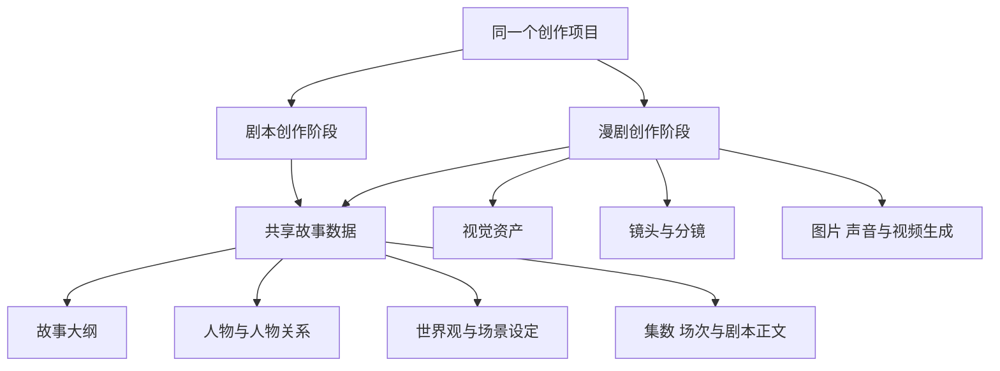
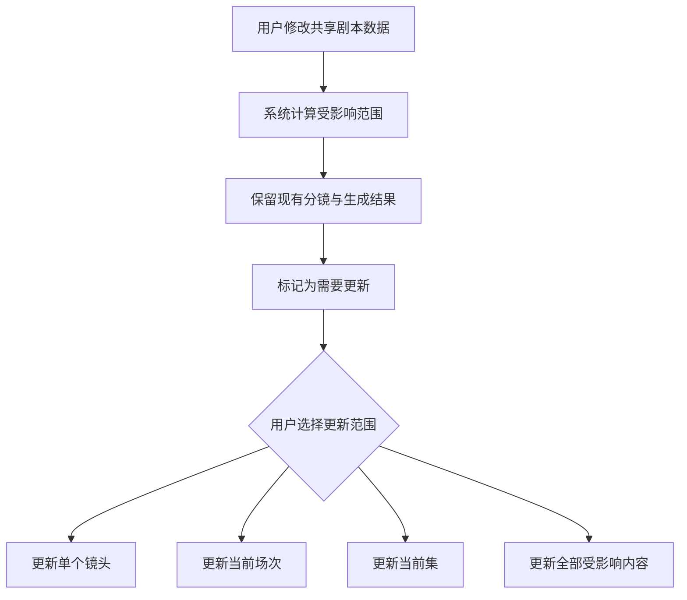

# 📚 剧本创作与漫剧创作功能总览

## 🎯 文档目的

本文用于明确 NovaNova Studio 中“剧本创作”和“漫剧创作”两个菜单的产品定位、功能边界、继承关系与数据联动规则。

- **剧本创作**负责把创意发展为完整、可分析、可持续修改的结构化剧本。
- **漫剧创作**继承剧本创作的全部能力，并负责把剧本继续转化为视觉资产、分镜、图片、声音和视频。
- 两个菜单操作的是**同一个创作项目**，不会因为进入漫剧创作而复制一份剧本数据。

相关详细规格：

- [剧本创作功能规格](./剧本创作功能规格.md)
- [漫剧创作功能规格](./漫剧创作功能规格.md)

---

## 📌 状态与优先级说明

### 功能状态

| 状态 | 含义 |
| --- | --- |
| 现有 | 项目中已经存在，可以直接复用的能力 |
| 规划 | 本文定义、尚待实现的产品能力 |
| 后续 | 不属于首期闭环，待核心流程稳定后再实现的能力 |

### 功能优先级

| 优先级 | 含义 |
| --- | --- |
| P0 | 首期核心能力，缺失时无法形成完整主流程 |
| P1 | 增强能力，显著改善质量、效率或可控性 |
| P2 | 后续能力，核心流程稳定后按实际需求建设 |

---

## 🔍 当前项目现状

> **实现更新（2026-09-20）：** “剧本创作”P0 与 P1 已进入代码实现，包含关系数据模型、项目库、三栏工作台、结构化编辑、动作式 AI 草稿、专业分析、人物关系图、版本和生产准备度入口。当前代码尚未执行构建、自动化测试或浏览器验收，状态记为“已实现待验证”。“漫剧创作”仍为占位页，现有可复用能力继续来自无限画布和分镜接口。

| 区域 | 当前状态 | 本次规划的处理方式 |
| --- | --- | --- |
| 剧本创作菜单 | P0/P1 已实现待验证 | 已建设项目库与纯剧本创作工作台 |
| 漫剧创作菜单 | 已有独立菜单与页面，页面仍为“功能建设中” | 规划为叙事视频生产工作台 |
| 无限画布 | 已支持文本、图片、视频、音频、分镜脚本、合成视频等节点 | 作为漫剧创作的可复用生产执行空间 |
| 分镜能力 | 已支持根据剧本文本生成镜头和角色、场景、道具清单 | 作为漫剧创作“剧本转分镜”的基础能力 |
| 提示词与资产图片 | 已支持镜头提示词合成和分镜资产图片生成 | 纳入漫剧创作的视觉生产流程 |

现有画布和分镜能力不代表漫剧工作台已经完成。漫剧项目入口、生产阶段页面、下游数据模型和上游变更联动仍属于规划能力；剧本工作台的 P0/P1 则处于“已实现待验证”状态。

---

## 🧭 产品定位与功能边界

| 功能领域 | 剧本创作 | 漫剧创作 |
| --- | --- | --- |
| 项目入口 | 新建、查看和编辑剧本项目 | 新建完整项目，或选择已有剧本继续制作 |
| AI 灵感创作 | ✅ 负责 | ✅ 直接继承 |
| 故事梗概与大纲 | ✅ 负责 | ✅ 直接继承 |
| 集数与场次管理 | ✅ 负责 | ✅ 直接继承 |
| 人物设定 | 人物身份、性格、动机、关系等文字设定 | 继承文字设定，并增加参考图、三视图、表情和服装等视觉资产 |
| 世界观与场景 | 世界规则、地点、时间等文字设定 | 继承文字设定，并增加场景参考图、光线、天气和多角度视觉资产 |
| 剧本编辑与优化 | ✅ 负责 | ✅ 直接继承 |
| 剧本分析 | 剧情、人物动机、节奏和文本逻辑 | 继承剧本分析，并增加视觉连续性和镜头衔接检查 |
| 场次与镜头拆分 | 只维护剧本场次，不生成镜头 | ✅ 将场次转换为可生产镜头 |
| 分镜板与镜头清单 | ❌ 不包含 | ✅ 负责 |
| 镜头提示词 | ❌ 不包含 | ✅ 负责 |
| 图片、视频与声音生成 | ❌ 不包含 | ✅ 负责 |
| 成片编排 | ❌ 不包含 | ✅ 负责 |

> 场次（Scene）是发生在同一时间和地点的一段连续剧情；镜头（Shot）是一次连续拍摄或生成的最小画面单元；分镜板（Storyboard）是按顺序展示镜头画面的视觉规划；镜头清单（Shot List）是面向生产执行的结构化镜头表。

---

## 🔗 模块继承关系

继承的含义是共享能力与共享数据，而不是复制页面或复制项目：

1. 在剧本创作中修改故事、人物、世界观或剧本正文，漫剧创作读取到的是同一份最新数据。
2. 漫剧创作可以直接使用剧本创作的编辑器、AI 助手、分析和版本能力。
3. 漫剧创作新增的视觉资产、镜头、生成结果不会出现在剧本创作的核心工作区中，避免纯写作流程被生产配置干扰。

---

## 🎬 完整创作流程

- 从创意到结构化剧本属于**剧本创作**。
- 从视觉资产到成片编排属于**漫剧创作扩展能力**。
- 用户可以在任何剧本阶段进入漫剧创作；系统应先展示生产准备度和缺失项，不得在未确认时自动补写或自动产生生成费用。

---

## 🗂️ 共享项目与菜单入口

### 剧本创作菜单

- 展示用户有权访问的全部创作项目。
- 默认突出剧本完成度、最近修改时间、集数和当前创作阶段。
- 进入项目后默认打开故事概览或最近编辑的剧本位置。
- 已进入生产阶段的项目仍可返回修改共享剧本。

### 漫剧创作菜单

- 支持从零新建项目，新项目仍从创意、人物和剧本阶段开始。
- 支持选择已有剧本项目继续制作，不创建副本。
- 默认突出制作进度、待更新项、已完成镜头和生成任务状态。
- 菜单名称保持“漫剧创作”，工作台能力同时面向漫剧、真人短剧、动画、广告、音乐视频和故事短片等叙事视频。

### 项目共享内容

| 数据 | 是否共享 | 说明 |
| --- | --- | --- |
| 项目基础信息 | 是 | 名称、简介、项目类型、目标受众等 |
| 故事与大纲 | 是 | 梗概、结构、主线、冲突、反转和结局 |
| 人物与关系 | 是 | 人物文字设定由两端共用，视觉资产由漫剧创作扩展 |
| 世界观与场景 | 是 | 文字设定由两端共用，场景图片由漫剧创作扩展 |
| 集数、场次和正文 | 是 | 始终保持单一数据来源 |
| 镜头与分镜 | 漫剧扩展 | 关联到来源集数和场次 |
| 生成资产与成片 | 漫剧扩展 | 关联到人物、场景、道具或镜头 |

---

## 🔄 上游修改与下游更新

上游内容变化后，系统不得自动覆盖用户已经调整的分镜和生成结果，也不得自动发起可能扣费的任务。

| 上游变化 | 可能受影响的下游内容 | 产品行为 |
| --- | --- | --- |
| 剧情或场次正文变化 | 镜头、分镜图、提示词、对白、视频 | 标记对应场次及镜头为“需要更新” |
| 人物文字设定变化 | 人物视觉资产、关联镜头、配音设定 | 标记引用该人物的内容为“需要更新” |
| 场景文字设定变化 | 场景视觉资产、关联镜头 | 标记引用该场景的内容为“需要更新” |
| 道具描述变化 | 道具视觉资产、关联镜头 | 标记引用该道具的内容为“需要更新” |
| 视觉资产版本变化 | 分镜图、镜头图片和视频 | 保留旧版本并提示切换或重新生成 |

每个“需要更新”项必须显示变化来源和影响范围。用户可以继续保留旧结果，也可以选择局部或全部重新生成。

---

## 🚀 分期优先级

| 优先级 | 剧本创作 | 漫剧创作扩展 |
| --- | --- | --- |
| P0 | 项目库、AI 分步创作、大纲、人物与世界观、分集分场编辑、进入漫剧创作 | 项目承接、生产设置、视觉资产、镜头拆分、分镜、提示词、图片与视频生成、画布复用、需要更新机制 |
| P1 | 人物关系图、AI 优化、专业诊断、版本与修改对比、剧本模板 | 连续性检查、配音与声音、视觉资产多版本、批量生产与进度管理 |
| P2 | 高级结构模板、团队评论与协作 | 高级镜头调度、复杂声音编排、团队审片与生产协作 |

---

## ✅ 总体验收标准

1. 两个菜单的定位和功能边界清晰，同一功能不存在两个相互独立的数据来源。
2. 漫剧创作可以新建完整项目，也可以无复制地承接已有剧本项目。
3. 剧本创作不出现分镜、视觉资产、配音、图片生成或视频生成等生产配置。
4. 漫剧创作可以访问全部共享剧本能力，并能继续完成资产、镜头、分镜和生成流程。
5. 修改上游内容时保留下游结果，准确标记受影响内容，并由用户确认更新范围。
6. 所有可能产生费用或覆盖内容的操作必须由用户明确确认。
7. 页面必须区分现有能力和规划能力，不得将占位页面描述为已经交付的完整工作台。

---

## 🚫 本文不包含

- 具体接口路径、请求结构或响应结构。
- 数据库表、字段和迁移方案。
- 前后端组件拆分或技术架构设计。
- 模型渠道、计费规则和具体模型参数。
